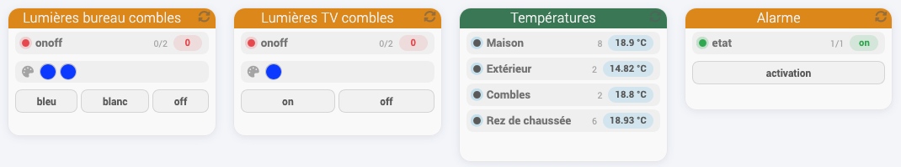

# Groupir - plugin Jeedom

Groupir regroupe des équipements (et des scénarios) Jeedom. Chaque groupe, par exemple « Lumières salon », devient un équipement avec ses propres commandes :

- des **commandes info**, qui indiquent si les équipements sont dans l'état attendu (ex. `on` vaut `ok` si toutes les lumières sont allumées, sinon `ko`, valeurs personnalisables) ;
- des **commandes action**, qui pilotent tous les équipements d'un coup (ex. `Allumer` allume les lumières, règle leur luminosité et leur couleur).

Ces commandes s'utilisent comme n'importe quelle commande Jeedom : scénarios, widgets, historique, alertes...

## Fonctionnalités

- Commandes info avec une règle au choix : tous, au moins un ou au moins N équipements conformes
- Conditions variées : égal, différent, supérieur, inférieur, contient...
- Commandes action enchaînant plusieurs actions par équipement (ex. On, Luminosité, Couleur), avec une pause optionnelle entre deux actions
- Scénarios dans les groupes : état (actif, en cours...) pour les infos ; lancer, arrêter, activer, désactiver pour les actions
- Widget dédié : état de chaque commande info, couleur actuelle des lumières, un bouton par commande action, mis à jour en direct
- Interface en français, anglais, allemand, espagnol et italien

## Installation

Depuis le Market Jeedom : *Plugins > Gestion des plugins > Market*, rechercher **Groupir**, installer puis activer le plugin. Aucune configuration globale n'est nécessaire.

Prérequis : Jeedom 4.2 ou supérieur.

## Documentation

- [Français](docs/fr_FR/index.md) · [English](docs/en_US/index.md) · [Deutsch](docs/de_DE/index.md) · [Español](docs/es_ES/index.md) · [Italiano](docs/it_IT/index.md)
- [Changelog](docs/fr_FR/changelog.md)

## Branches

- `stable` : version publiée sur le Market
- `beta` : version de test

## Support

Questions et retours sur le [forum Jeedom Community](https://community.jeedom.com/tag/plugin-groupir).

## Licence

[AGPL-3.0](LICENSE)
