Beschreibung
===

Mit Groupir lassen sich **Geräte gruppieren** (und Szenarien). Jede Gruppe, zum Beispiel „Wohnzimmerlichter", ist ein Jeedom-Gerät mit eigenen Befehlen:

- **Info-Befehle** geben den Zustand der Gruppe an (z. B. `on` ist `1`, wenn alle Lichter eingeschaltet sind, oder die Durchschnittstemperatur der Räume);
- **Aktionsbefehle** steuern alle Geräte auf einmal (z. B. `Einschalten` schaltet die Lichter ein und stellt Helligkeit und Farbe ein).

Diese Befehle funktionieren wie jeder andere Jeedom-Befehl: Szenarien, Widgets, Verlauf, Warnungen...

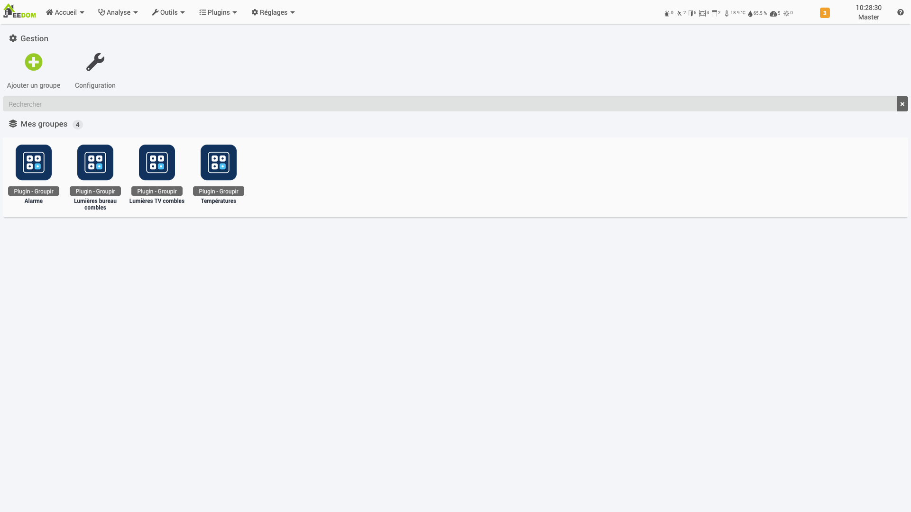

Plugin-Konfiguration
===

Aktivieren Sie das Plugin nach der Installation aus dem Market. **Es ist keine globale Konfiguration erforderlich**: Jede Gruppe wird über ihr Gerät im Reiter *Zuordnungen* konfiguriert.

Die Funktion **cron** ist aktiv: Jede Minute berechnet das Plugin die Gruppen neu, deren Infobefehle vom Zustand eines Szenarios abhängen oder die Aktualität der Daten prüfen. Die Log-Stufe *Debug* beschreibt jede Neuberechnung und jede ausgeführte Aktion, was bei der Fehlersuche hilft.

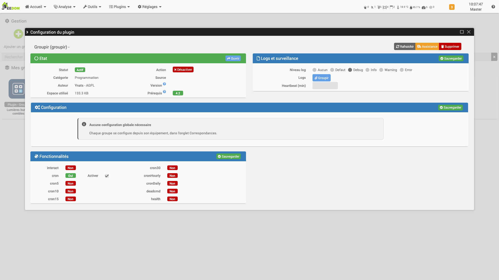

Die Oberfläche ist auf Französisch, Englisch, Deutsch, Spanisch und Italienisch verfügbar.

Eine Gruppe erstellen
===

Klicken Sie auf **Gruppe hinzufügen**, geben Sie einen Namen ein und konfigurieren Sie dann die beiden Reiter.

Reiter „Allgemein"
---

Name, übergeordnetes Objekt, Kategorie, Optionen *Aktivieren* / *Sichtbar* und Beschreibung, wie bei jedem Gerät.

Der Block **Verknüpfte Szenarien** listet:

- die Szenarien, die **diese Gruppe verwenden** (einen ihrer Befehle als Auslöser, Bedingung oder Aktion);
- die Szenarien, die **von dieser Gruppe gesteuert werden** (von einem ihrer Aktionsbefehle gestartet, gestoppt, aktiviert oder deaktiviert).

Ein Klick öffnet das Szenario.

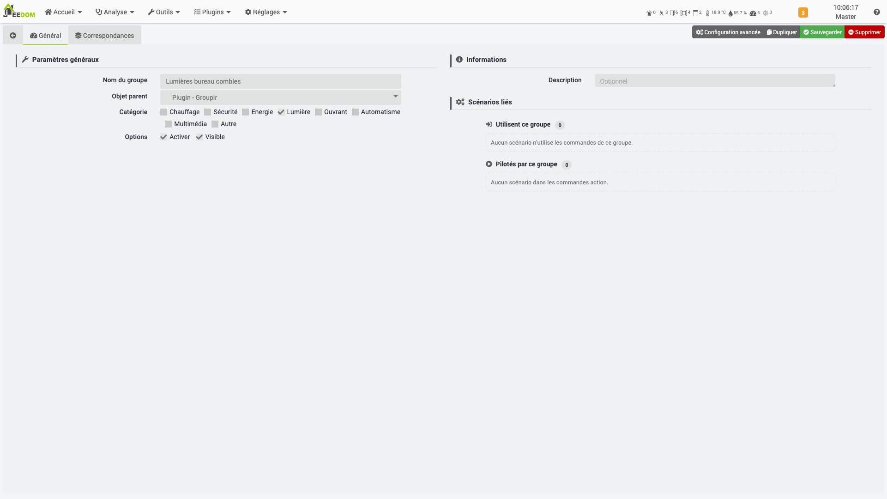

Reiter „Zuordnungen"
---

Die Gruppe enthält **Befehle**, von denen jeder eine Untergruppe von Geräten ist:

- **Info-Befehl** (blaues Abzeichen): berechnet einen Zustand aus den Geräten;
- **Aktionsbefehl** (oranges Abzeichen): führt Aktionen auf den Geräten aus.

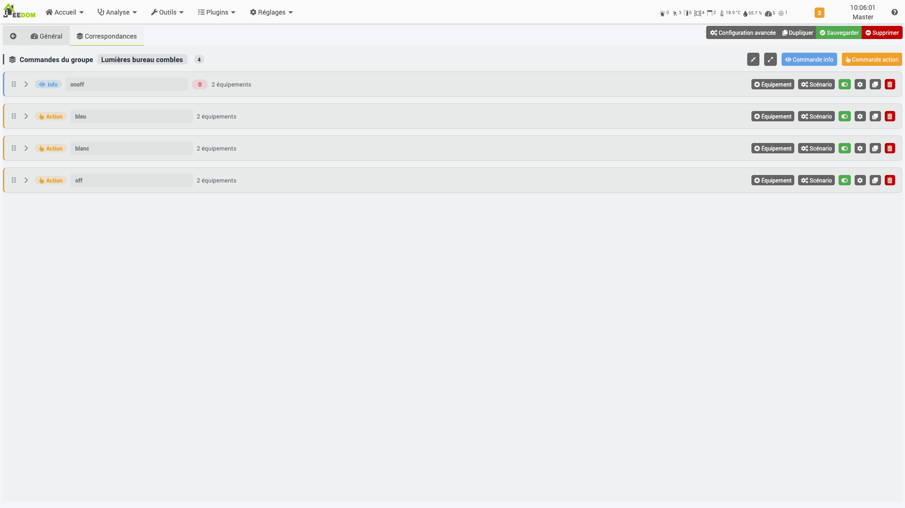

Geben Sie dem Befehl einen **Namen**: Er wird zum Namen des Gruppenbefehls. Fügen Sie dann mit der Schaltfläche **Gerät** eine Zeile pro Gerät hinzu (oder mit der Schaltfläche **Szenario** eine Zeile pro Szenario). Jede Zeile wird von links nach rechts ausgefüllt: **Objekt**, **Gerät**, **Befehl**. Jede Liste hat ein Feld *Filter*; ein Filter, der nur ein Ergebnis übrig lässt, wählt es automatisch aus, und in einem Aktionsbefehl wird ein bereits verwendetes Gerät nicht mehr angeboten. In einem Infobefehl kann dasselbe Gerät in mehreren Zeilen vorkommen (z. B. Temperatur und Luftfeuchtigkeit desselben Sensors), ein bereits gewählter Infobefehl wird jedoch nicht mehr angeboten.

Der **Schalter** in der Kopfzeile aktiviert oder deaktiviert einen Befehl, ohne ihn zu löschen. Ein deaktivierter Befehl wird nicht mehr berechnet und nicht mehr im Widget angezeigt, und ein deaktivierter Aktionsbefehl führt nichts mehr aus. Sein Jeedom-Befehl bleibt erhalten (Historie, Szenarien, die ihn verwenden), und ein Infobefehl behält seinen letzten Wert.

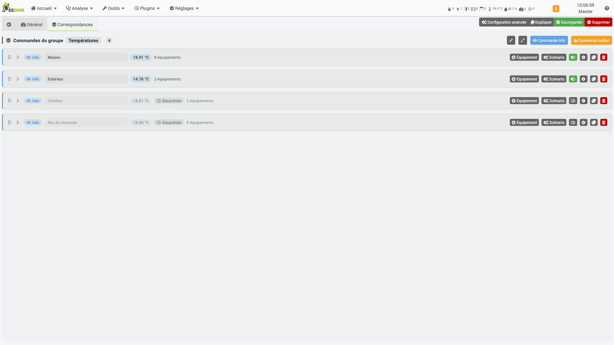

### Info-Befehl

Für jedes Gerät: der Info-Befehl, eine Bedingung (*gleich*, *ungleich*, *größer als*, *enthält*...) und der **erwartete Wert** (der aktuelle Wert wird als Hinweis angezeigt).

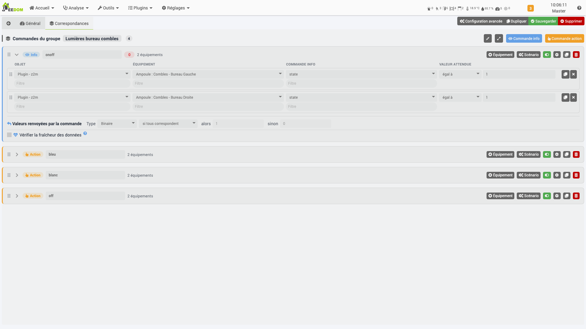

Der **Typ** des Befehls wird wie in Jeedom gewählt, und die angebotenen Optionen hängen davon ab:

- **Binär**: der Befehl ist `1`, wenn die Regel erfüllt ist, sonst `0` (kompatibel mit binären Widgets und generischen Typen);
- **Numerisch**: der Befehl berechnet einen Wert aus den Zeilen:
  - **Durchschnitt**, **Höchster Wert**, **Niedrigster Wert**, **Summe** oder **Median** der Werte der Infobefehle (z. B. Durchschnittstemperatur der Räume), mit der gewählten Anzahl an **Dezimalstellen**. Bedingung und erwarteter Wert der Zeilen werden nicht verwendet; ein Szenario zählt `1`, wenn es im gewählten Zustand ist, sonst `0`. Die Einheit der ersten Info (z. B. `°C`) wird automatisch übernommen;
  - **Anzahl der Übereinstimmungen**: Anzahl der Zeilen, die ihre Bedingung erfüllen (z. B. Anzahl offener Fenster);
  - **Gemäß der Regel (dann / sonst)**: wie Andere, mit numerischen Werten (Standard `1` / `0`);
- **Andere**: freier Text, der Befehl nimmt den Wert **alors** (Standard `on`) an, wenn die Regel erfüllt ist, andernfalls den Wert **sinon** (Standard `off`).

Die Regel (Binär, Andere und Numerisch „gemäß der Regel“):

- **wenn alle übereinstimmen** (Standard): alle Zeilen müssen übereinstimmen;
- **wenn mindestens eine übereinstimmt**: z. B. „mindestens ein Licht an“;
- **wenn mindestens N übereinstimmen**: z. B. mindestens 2 von 4 Fenstern offen.

**Typerkennung**: anhand der gewählten Infobefehle (binär oder Werte `0` / `1`: Binär; numerisch: Numerisch; sonst Andere) **schlägt** das Plugin einen Typwechsel **vor**. Ohne Ihre Zustimmung wird nichts geändert: klicken Sie auf *Wechseln zu...* zum Übernehmen oder auf *Behalten...*, um den Vorschlag zu ignorieren.

**Aktualität der Daten prüfen** (Option jedes Infobefehls, standardmäßig deaktiviert): eine Zeile, deren Gerät innerhalb der gewählten Frist (standardmäßig 60 Minuten) nicht aktualisiert wurde oder die Jeedom als Timeout meldet, wird **ignoriert**: sie zählt weder in der Regel noch in der Berechnung. Beispiel: ein Temperatursensor mit leerer Batterie verfälscht den Durchschnitt nicht mehr. Als letzte Aktualisierung gilt die jüngste aus letzter Kommunikation des Geräts und Datum des Werts. Das Widget zeigt dann eine **Warnung** an (mit der Maus darüberfahren für die Liste der ausgefallenen Geräte), Ausfall und Wiederherstellung werden im Plugin-Log vermerkt. Diese Prüfung erfolgt jede Minute.

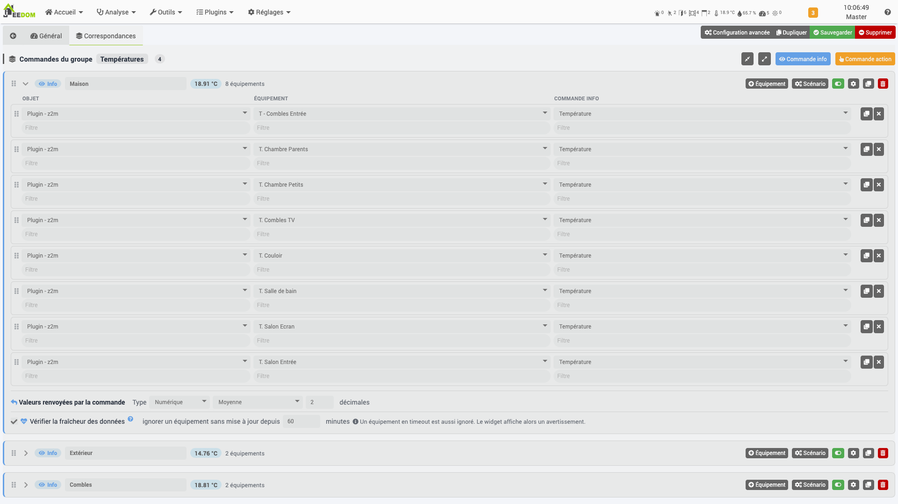

### Aktionsbefehl

Für jedes Gerät: ein oder mehrere Aktionsbefehle, die der Reihe nach ausgeführt werden. Die Schaltfläche **+ Commande** verkettet mehrere Aktionen auf demselben Gerät (z. B. `On`, dann `Helligkeit` auf 254, dann `Farbe`).

Das Feld **Wert** passt sich dem Befehlstyp an: Zahl (mit dem erlaubten Bereich als Hinweis, z. B. `153 bis 500`, und auf diesen Bereich begrenzter Eingabe), Farbe, Liste oder Nachricht. Für einen Befehl ohne Wert (z. B. `On`) wird kein Feld angezeigt.

Die **Pause zwischen zwei Aktionen** (0 bis 30 Sekunden) verteilt die Aktionen zeitlich: nützlich für Lampen, die eine direkt nach dem Einschalten gesendete Farbe ignorieren.

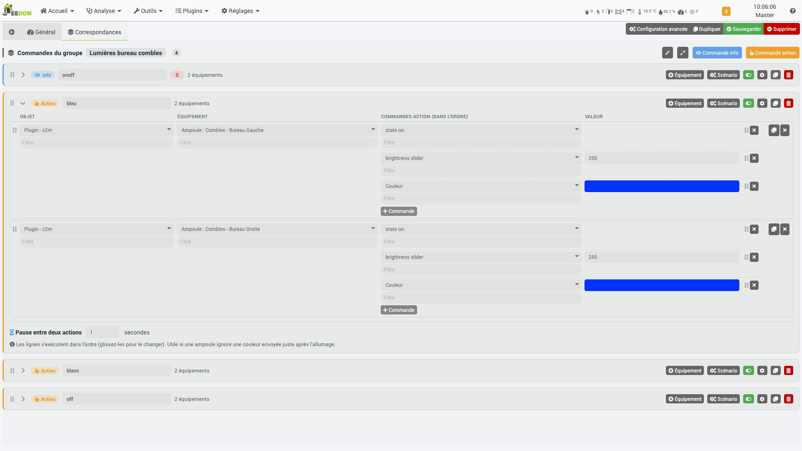

### Szenarien hinzufügen

Die Schaltfläche **Szenario** in der Kopfzeile eines Befehls fügt eine Szenario-Zeile hinzu. Wählen Sie die **Szenariogruppe** (optional, sie filtert die Liste) und dann das **Szenario**.

- **In einem Infobefehl** bezieht sich die Zeile auf den Zustand des Szenarios: **ist aktiv** / **ist inaktiv** (Szenario in Jeedom aktiviert oder deaktiviert), **läuft** / **ist gestoppt** (Szenario wird gerade ausgeführt oder nicht). Sie zählt als Zeile der Regel oder ist in einer numerischen Berechnung `1` / `0` wert. Szenario-Zeilen werden in einem **eigenen Block** unter den Geräten zusammengefasst, mit eigenen Spalten (*Szenariogruppe*, *Szenario*, *Erwarteter Zustand*). Jeedom meldet keine Zustandsänderungen von Szenarien: Diese Zeilen werden jede Minute neu berechnet (oder sofort mit dem Befehl *Aktualisieren*).
- **In einem Aktionsbefehl** **startet**, **stoppt**, **aktiviert** oder **deaktiviert** die Zeile das Szenario. Sie wird an ihrer Stelle in der Liste zusammen mit den Geräten ausgeführt (z. B. Lichter einschalten, dann das Szenario „Abendstimmung“ starten): Ziehen Sie sie, um die Reihenfolge zu ändern. Die Spalten heißen dann *Objekt / Gruppe* und *Gerät / Szenario*.
- Die Schaltfläche <i class="fas fa-clone"></i> klont eine Szenario-Zeile: gleiche Gruppe und gleiche Aktion / gleicher Zustand, Szenario auszuwählen.

Beispiel, eine Gruppe **Alarm**:

- Infobefehl `etat` (Typ *Andere*, Werte `on` / `off`): eine Szenario-Zeile *0 - Alarme - Activation* **ist aktiv**; sie ist `on`, solange das Szenario aktiviert ist;
- Aktionsbefehl `activation`: eine Szenario-Zeile *0 - Alarme - Activation* **Starten**, dann eine Gerätezeile (*Google Home Parle*), die „Alarme activée“ ansagt; Szenarien und Geräte werden in der Reihenfolge der Liste ausgeführt.

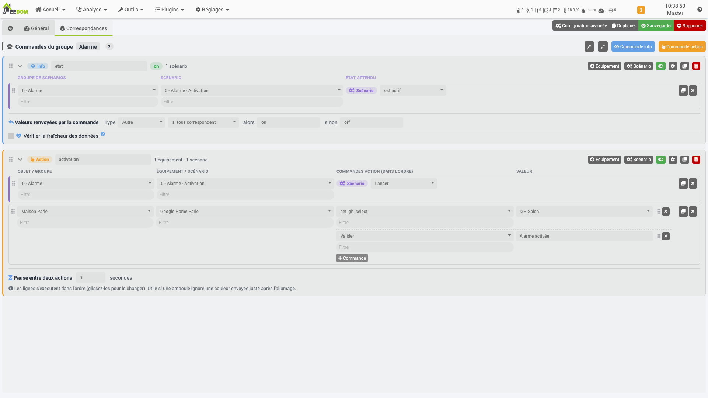

Szenarien, die von einem Aktionsbefehl gestartet, gestoppt, aktiviert oder deaktiviert werden, erscheinen im Reiter *Allgemein*, Block **Verknüpfte Szenarien** > *Von dieser Gruppe gesteuert*, mit Befehl und Aktion:

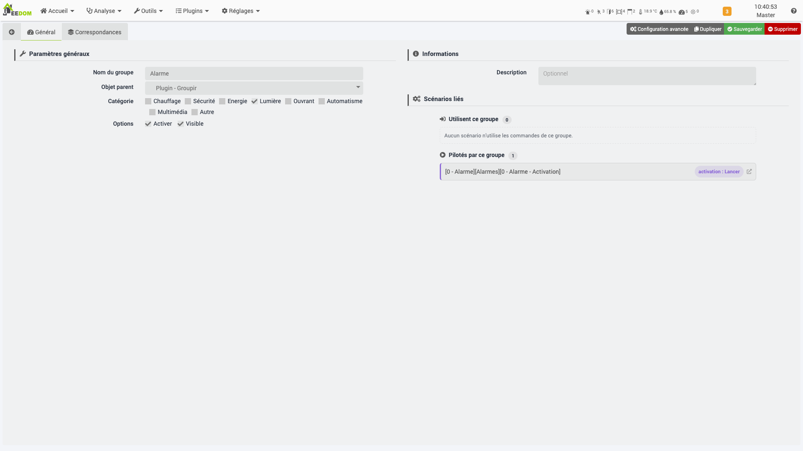

### Befehle organisieren

- <i class="fas fa-grip-vertical"></i> **Ziehen und Ablegen**: ordnet die Befehle (und damit die Widget-Schaltflächen), die Zeilen und die Aktionen eines Geräts neu.
- <i class="fas fa-chevron-right"></i> **Ein- / Ausklappen**: Die Befehle sind beim Öffnen der Gruppe eingeklappt; die Schaltflächen oben rechts klappen alle ein oder aus. Eingeklappt zeigt ein Infobefehl seinen **aktuellen Wert** in der Kopfzeile (grün oder rot gemäß der Regel, blau bei einer numerischen Berechnung, mit <i class="fas fa-exclamation-triangle"></i>, wenn Geräte ignoriert werden), live aktualisiert, sowie die Anzahl der Geräte und Szenarien. Der **Gruppenname** wird neben „Gruppenbefehle“ angezeigt.
- <i class="fas fa-clone"></i> **Zeile klonen**: fügt eine Zeile mit demselben Objekt und denselben Aktionen hinzu; sobald das Gerät gewählt ist, werden seine gleichnamigen Befehle mit denselben Werten ausgewählt. Auch eine Szenario-Zeile lässt sich klonen: gleiche Gruppe und gleiche Aktion / gleicher Zustand, Szenario auszuwählen.
- <i class="fas fa-clone"></i> **Befehl klonen**: dupliziert den gesamten Befehl unter dem Namen „… (copie)".
- <i class="fas fa-cog"></i> **Konfiguration**: öffnet die Jeedom-Konfiguration des Befehls (Verlauf, generischer Typ, Warnungen), sobald die Gruppe gespeichert ist.

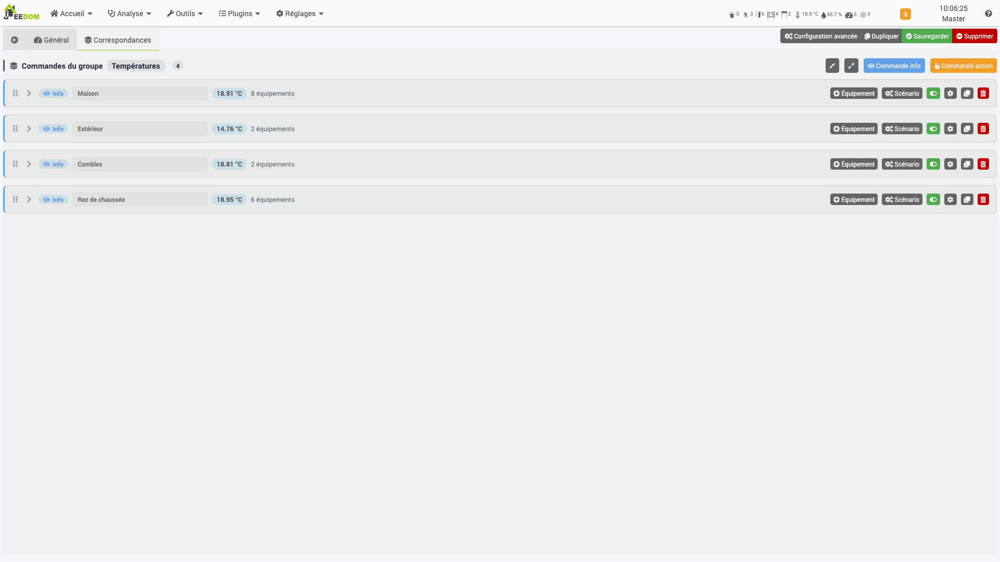

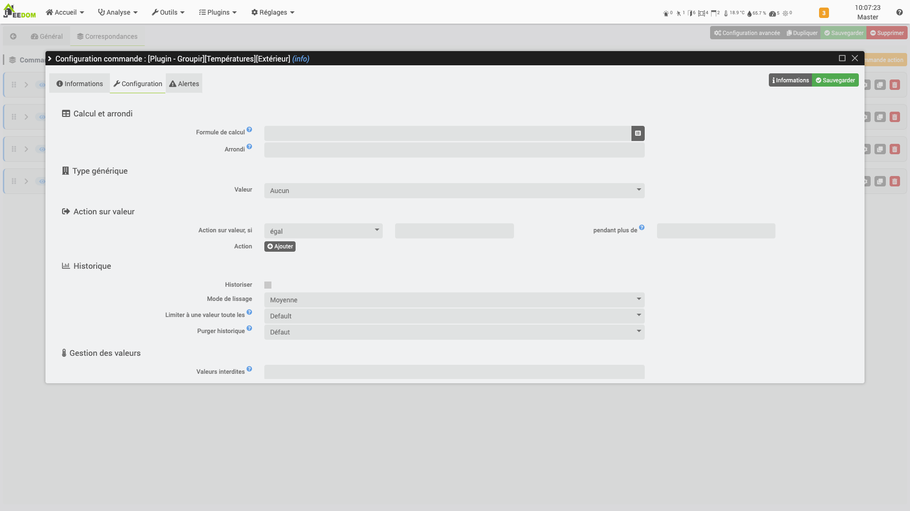

Eine Zeile, deren Gerät, Befehl oder Szenario gelöscht wurde, wird **rot** angezeigt. Das Speichern wird abgelehnt, solange eine Zeile unvollständig ist; eine Meldung nennt den Befehl und die zu korrigierende Zeile.

Befehle einer Gruppe
===

| Befehl | Typ | Funktion |
|---|---|---|
| *einer pro Info-Befehl* | info | Wert „alors" oder „sinon" gemäß der Regel oder Ergebnis der Berechnung (Numerisch: Durchschnitt, höchster Wert...) |
| *einer pro Aktionsbefehl* | action | Führt die Zeilen des Befehls der Reihe nach aus |
| Aktualisieren | action | Berechnet alle Info-Befehle der Gruppe neu |

Beispiel in einem Szenario: Auslöser *[Wohnzimmer][Wohnzimmerlichter][on] gleich 1*, Aktion *[Wohnzimmer][Wohnzimmerlichter][Einschalten]*.

Widget
===

Jede Gruppe hat ihr eigenes Widget:

- eine Zeile pro Info-Befehl mit einem grünen oder roten Punkt gemäß der Regel (blau bei einer numerischen Berechnung), der Anzahl übereinstimmender Geräte (z. B. `2/2`) oder Werte und dem Wert des Befehls mit seiner Einheit (z. B. `18.9 °C`); das Symbol <i class="fas fa-exclamation-triangle"></i> weist auf Geräte hin, die mangels aktueller Aktualisierung ignoriert werden (mit der Maus darüberfahren für die Liste);
- die **aktuelle Farbe** jedes Lichts der Gruppe (aus der Status-Info seines Farbbefehls gelesen oder aus einer Info mit dem generischen Typ *Lichtfarbe*);
- eine Schaltfläche pro Aktionsbefehl;
- das Symbol <i class="fas fa-sync-alt"></i> berechnet den Zustand der Gruppe neu.

Das Widget wird live aktualisiert. Ein ausgeblendeter Befehl (Symbol <i class="fas fa-cog"></i> > *Anzeigen*) erscheint dort nicht.
