Description
===

Groupir lets you **group devices** (and scenarios). Each group, for example "Living room lights", is a Jeedom device with its own commands:

- **info commands**, which give the state of the group (e.g. `on` is `1` when all the lights are on, or the average temperature of the rooms);
- **action commands**, which control all the devices at once (e.g. `Turn on` switches the lights on and sets their brightness and colour).

These commands work like any other Jeedom command: scenarios, widgets, history, alerts...

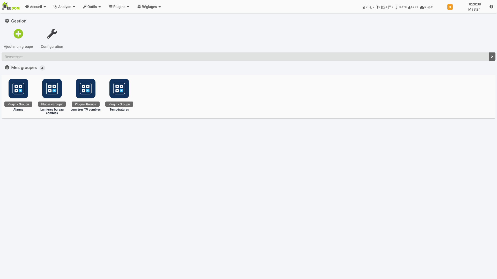

Plugin configuration
===

After installing it from the Market, enable the plugin. **No global configuration is needed**: each group is configured from its device, in the *Mappings* tab.

The **cron** feature is enabled: every minute, the plugin recalculates the groups whose info commands depend on the state of a scenario or check data freshness. The *Debug* log level details every recalculation and every executed action, which helps with troubleshooting.

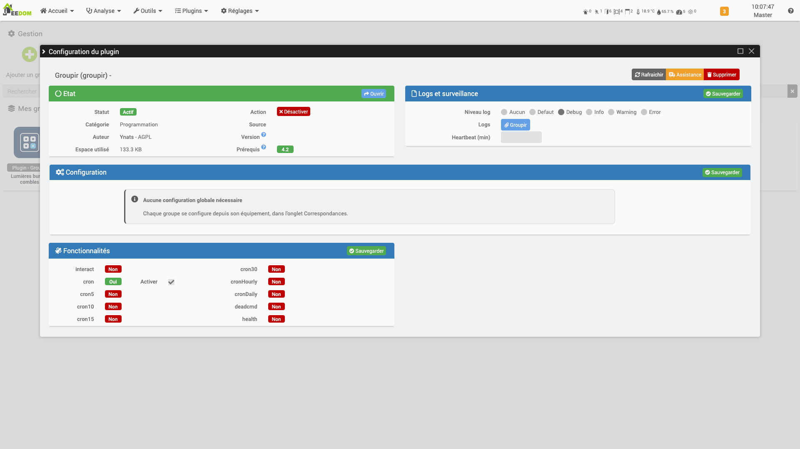

The interface is available in French, English, German, Spanish and Italian.

Creating a group
===

Click **Add a group**, give it a name, then configure the two tabs.

"General" tab
---

Name, parent object, category, *Enable* / *Visible* options and description, as for any device.

The **Linked scenarios** block lists:

- the scenarios that **use this group** (one of its commands as a trigger, condition or action);
- the scenarios **controlled by this group** (started, stopped, enabled or disabled by one of its action commands).

Click a scenario to open it.

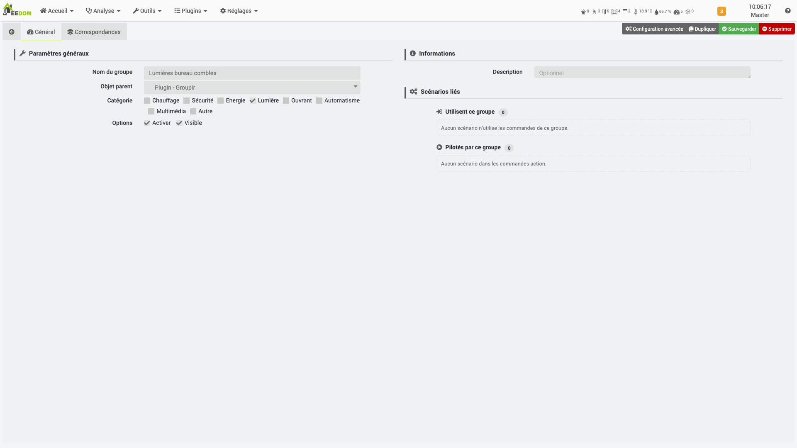

"Mappings" tab
---

The group contains **commands**, each one being a sub-group of devices:

- **Info command** (blue badge): computes a state from the devices;
- **Action command** (orange badge): runs actions on the devices.

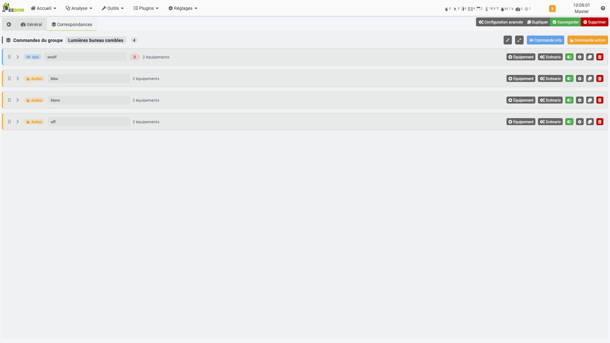

Give the command a **name**: it becomes the name of the group command. Then add one line per device with the **Device** button (or per scenario with the **Scenario** button). Each line is filled from left to right: **Object**, **Device**, **Command**. Every list has a *Filter* field; a filter that leaves a single result selects it automatically, and in an action command, a device already used is no longer offered. In an info command, the same device can appear on several lines (e.g. temperature and humidity of the same sensor), but an info command already chosen is no longer offered.

The **toggle** button in the header enables or disables a command without deleting it. A disabled command is no longer computed or shown in the widget, and a disabled action command no longer executes anything. Its Jeedom command is kept (history, scenarios using it) and an info command keeps its last value.

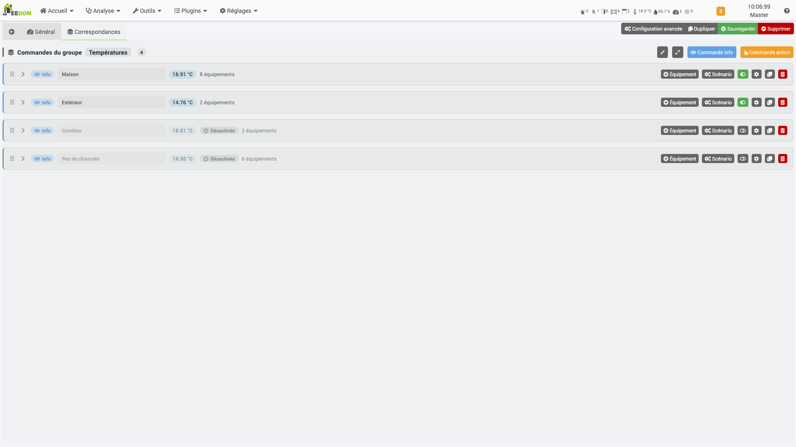

### Info command

For each device: the info command, a condition (*equal to*, *different from*, *greater than*, *contains*...) and the **expected value** (the current value is shown as a hint).

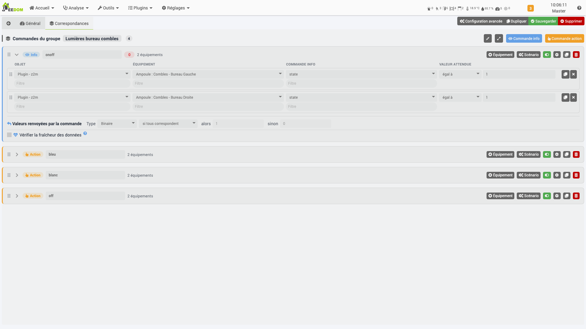

The command **type** is chosen as in Jeedom, and the available options depend on it:

- **Binary**: the command is `1` if the rule is met, otherwise `0` (works with binary widgets and generic types);
- **Numeric**: the command computes a value from the lines:
  - **Average**, **Highest**, **Lowest**, **Sum** or **Median** of the info command values (e.g. average room temperature), with the chosen number of **decimals**. The condition and expected value of the lines are not used; a scenario counts as `1` if it is in the chosen state, `0` otherwise. The unit of the first info (e.g. `°C`) is reused automatically;
  - **Number of matches**: number of lines meeting their condition (e.g. number of open windows);
  - **According to the rule (then / else)**: like Other, with numeric values (default `1` / `0`);
- **Other**: free text, the command takes the **then** value (default `on`) if the rule is met, otherwise the **else** value (default `off`).

The rule (Binary, Other, and Numeric "according to the rule"):

- **if all match** (default): every line must match;
- **if at least one matches**: e.g. "at least one light on";
- **if at least N match**: e.g. at least 2 windows open out of 4.

**Type detection**: based on the selected info commands (binary or `0` / `1` values: Binary; numeric: Numeric; otherwise Other), the plugin **suggests** changing the type. Nothing changes without your approval: click *Switch to...* to accept or *Keep...* to dismiss the suggestion.

**Check data freshness** (option of each info command, disabled by default): a line whose device has not been updated within the chosen delay (60 minutes by default), or that Jeedom reports in timeout, is **ignored**: it counts neither in the rule nor in the calculation. Example: a temperature sensor with a dead battery no longer skews the average. The last update used is the most recent of the device's last communication and the value date. The widget then shows a **warning** (hover it for the list of failing devices), and the failure and recovery are written to the plugin log. This check runs every minute.

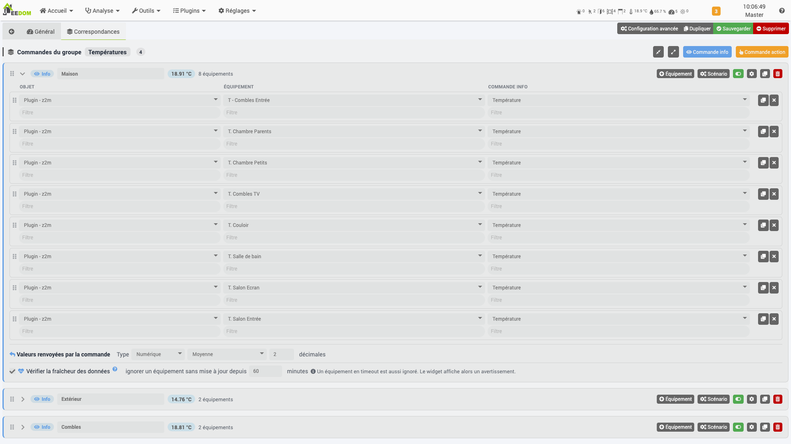

### Action command

For each device: one or more action commands, run in order. The **+ Commande** button chains several actions on the same device (e.g. `On`, then `Brightness` at 254, then `Colour`).

The **Value** field adapts to the command type: number (with the allowed range as a hint, e.g. `153 to 500`, and input limited to that range), colour, list or message. For a command without a value (e.g. `On`), no field is shown.

The **pause between two actions** (0 to 30 seconds) spaces out each action: useful for bulbs that ignore a colour sent right after being switched on.

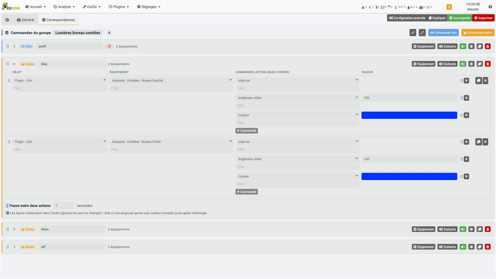

### Adding scenarios

The **Scenario** button in a command header adds a scenario line. Choose the **scenario group** (optional, it filters the list), then the **scenario**.

- **In an info command**, the line checks the state of the scenario: **is active** / **is inactive** (scenario enabled or disabled in Jeedom), **is running** / **is stopped** (scenario currently executing or not). It counts as a line of the rule, or is worth `1` / `0` in a numeric calculation. Scenario lines are grouped in a **separate block**, below the devices, with their own columns (*Scenario group*, *Scenario*, *Expected state*). Jeedom does not report scenario state changes: these lines are recalculated every minute (or immediately with the *Refresh* command).
- **In an action command**, the line **starts**, **stops**, **enables** or **disables** the scenario. It runs at its place in the list, together with the devices (e.g. turn on the lights, then start the "Evening mood" scenario): drag it to change the order. The columns then become *Object / Group* and *Device / Scenario*.
- The <i class="fas fa-clone"></i> button clones a scenario line: same group and same action / state, scenario to choose.

Example, an **Alarm** group:

- info command `etat` (type *Other*, values `on` / `off`): a scenario line *0 - Alarme - Activation* **is active**; it is `on` as long as the scenario is enabled;
- action command `activation`: a scenario line *0 - Alarme - Activation* **Start**, then a device line (*Google Home Parle*) announcing "Alarme activée"; scenarios and devices run in the order of the list.

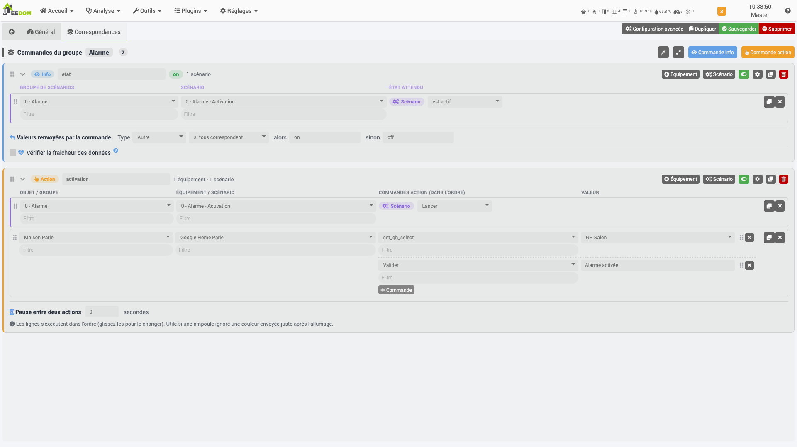

Scenarios started, stopped, enabled or disabled by an action command appear in the *General* tab, **Linked scenarios** block > *Controlled by this group*, with the command and the action:

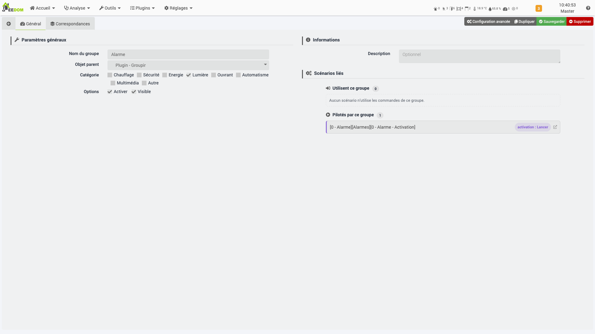

### Organising commands

- <i class="fas fa-grip-vertical"></i> **Drag and drop**: reorders the commands (and therefore the widget buttons), the lines and the actions of a device.
- <i class="fas fa-chevron-right"></i> **Collapse / expand**: commands are collapsed when the group opens; the buttons at the top right collapse or expand them all. When collapsed, an info command shows its **current value** in its header (green or red according to the rule, blue for a numeric calculation, with <i class="fas fa-exclamation-triangle"></i> if devices are ignored), updated live, along with the number of devices and scenarios. The **group name** is shown next to "Group commands".
- <i class="fas fa-clone"></i> **Clone a line**: adds a line with the same object and the same actions; once the device is chosen, its commands with the same names are selected with the same values. A scenario line can be cloned too: same group and same action / state, scenario to choose.
- <i class="fas fa-clone"></i> **Clone a command**: duplicates the whole command, named "… (copie)".
- <i class="fas fa-cog"></i> **Configuration**: opens the Jeedom configuration of the command (history, generic type, alerts), once the group has been saved.

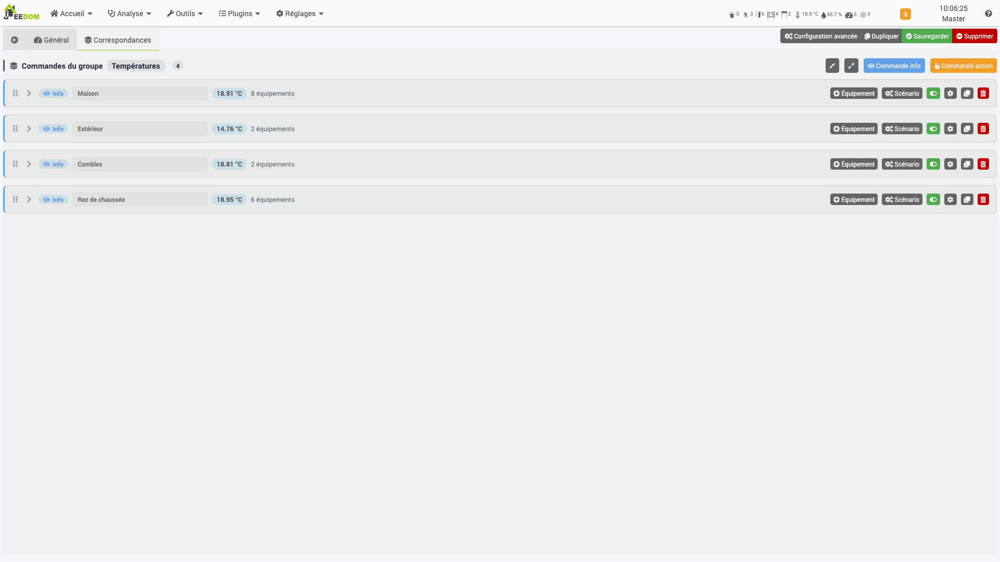

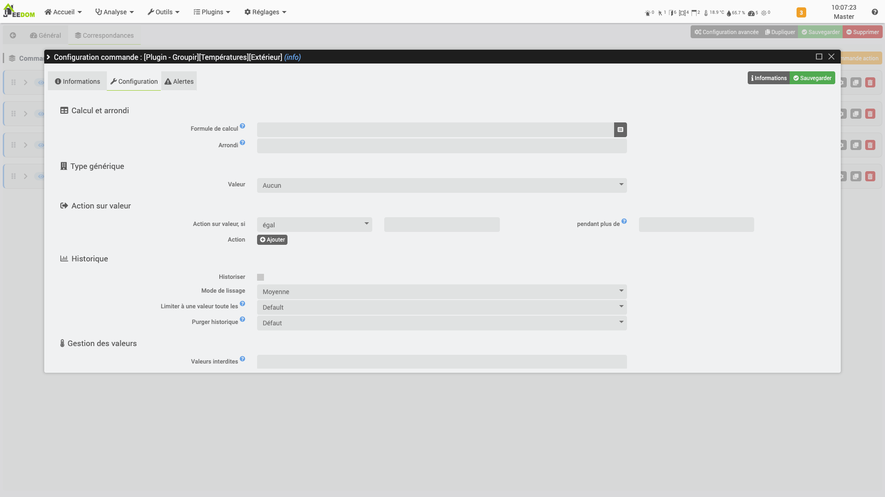

A line whose device, command or scenario has been deleted is shown **in red**. Saving is refused while a line is incomplete, with a message giving the command and the line to fix.

Group commands
===

| Command | Type | Role |
|---|---|---|
| *one per info command* | info | "then" or "else" value according to the rule, or result of the calculation (Numeric: average, highest...) |
| *one per action command* | action | Runs the lines of the command, in order |
| Refresh | action | Recalculates all the info commands of the group |

Example in a scenario: trigger *[Living room][Living room lights][on] equal to 1*, action *[Living room][Living room lights][Turn on]*.

Widget
===

Each group has its own widget:

- one line per info command, with a green or red dot according to the rule (blue for a numeric calculation), the number of matching devices (e.g. `2/2`) or of values, and the command value with its unit (e.g. `18.9 °C`); the <i class="fas fa-exclamation-triangle"></i> icon flags devices ignored for lack of recent update (hover it for the list);
- the **current colour** of each light of the group (read from the state info of its colour command, or from an info with the *Light colour* generic type);
- one button per action command;
- the <i class="fas fa-sync-alt"></i> icon recalculates the state of the group.

The widget updates live. A hidden command (<i class="fas fa-cog"></i> icon > *Display*) does not appear in it.
