Descripción
===

Groupir permite **agrupar equipos** (y escenarios). Cada grupo, por ejemplo «Luces del salón», es un equipo de Jeedom con sus propios comandos:

- **comandos info**, que dan el estado del grupo (p. ej. `on` vale `1` si todas las luces están encendidas, o la temperatura media de las habitaciones);
- **comandos acción**, que controlan todos los equipos a la vez (p. ej. `Encender` enciende las luces y ajusta su brillo y su color).

Estos comandos se usan como cualquier comando de Jeedom: escenarios, widgets, historial, alertas...

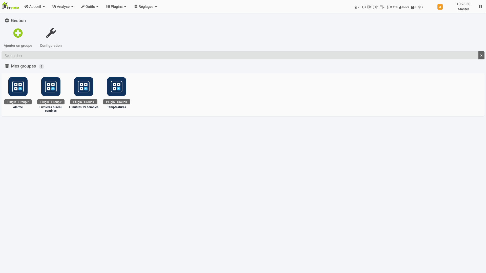

Configuración del plugin
===

Tras instalarlo desde el Market, active el plugin. **No se necesita ninguna configuración global**: cada grupo se configura desde su equipo, en la pestaña *Correspondencias*.

La función **cron** está activa: cada minuto, el plugin recalcula los grupos cuyos comandos info dependen del estado de un escenario o comprueban la actualidad de los datos. El nivel de log *Debug* detalla cada recálculo y cada acción ejecutada, lo que ayuda al diagnóstico.

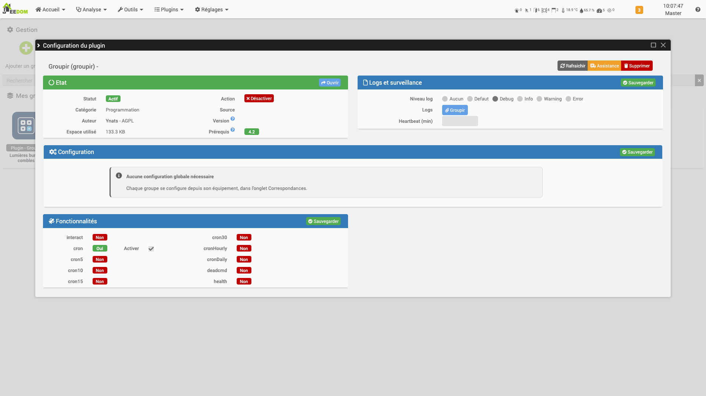

La interfaz está disponible en francés, inglés, alemán, español e italiano.

Crear un grupo
===

Haga clic en **Añadir un grupo**, asígnele un nombre y configure las dos pestañas.

Pestaña «General»
---

Nombre, objeto padre, categoría, opciones *Activar* / *Visible* y descripción, como en cualquier equipo.

El bloque **Escenarios vinculados** muestra:

- los escenarios que **usan este grupo** (uno de sus comandos como disparador, condición o acción);
- los escenarios **controlados por este grupo** (iniciados, detenidos, activados o desactivados por uno de sus comandos acción).

Un clic abre el escenario.

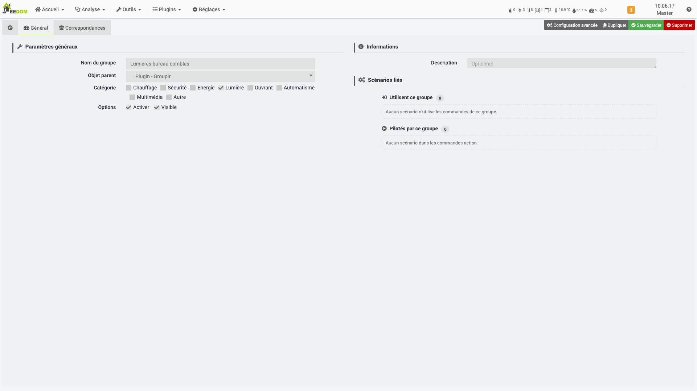

Pestaña «Correspondencias»
---

El grupo contiene **comandos**, cada uno de ellos un subgrupo de equipos:

- **Comando info** (etiqueta azul): calcula un estado a partir de los equipos;
- **Comando acción** (etiqueta naranja): ejecuta acciones sobre los equipos.

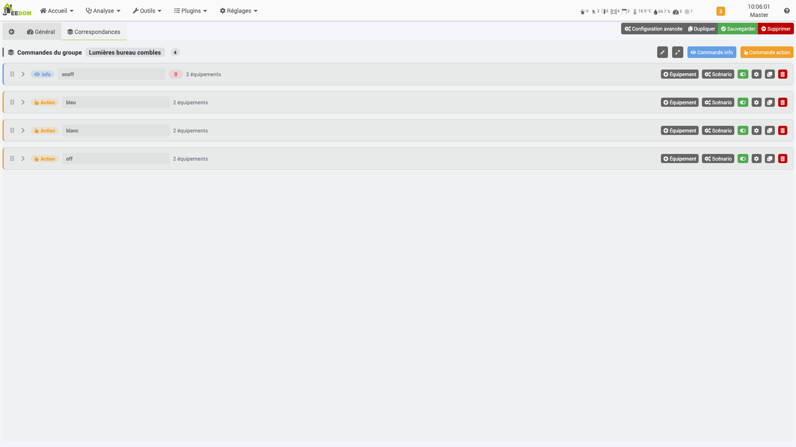

Asigne un **nombre** al comando: será el nombre del comando del grupo. Después añada una línea por equipo con el botón **Equipo** (o por escenario con el botón **Escenario**). Cada línea se rellena de izquierda a derecha: **Objeto**, **Equipo**, **Comando**. Cada lista tiene un campo *Filtro*; un filtro que deja un solo resultado lo selecciona automáticamente, y en un comando acción, un equipo ya presente deja de proponerse. En un comando info, un mismo equipo puede aparecer en varias líneas (p. ej. temperatura y humedad de una misma sonda), pero un comando info ya elegido deja de proponerse.

El botón **interruptor** del encabezado activa o desactiva un comando sin eliminarlo. Un comando desactivado ya no se calcula ni se muestra en el widget, y un comando acción desactivado ya no ejecuta nada. Su comando Jeedom se conserva (historial, escenarios que lo usan) y un comando info conserva su último valor.

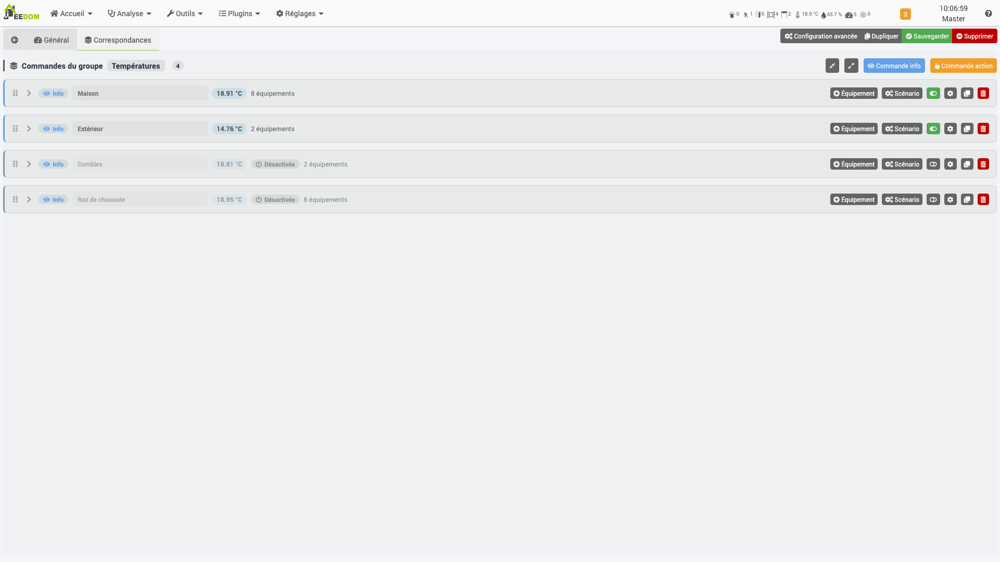

### Comando info

Para cada equipo: el comando info, una condición (*igual a*, *distinto de*, *mayor que*, *contiene*...) y el **valor esperado** (el valor actual se muestra como indicación).

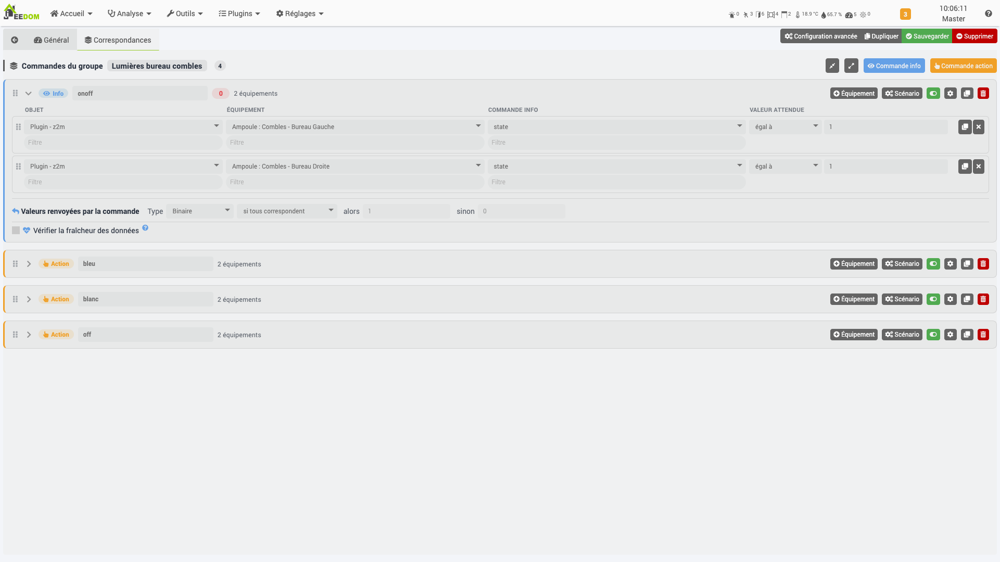

El **tipo** del comando se elige como en Jeedom, y las opciones propuestas dependen de él:

- **Binario**: el comando vale `1` si se cumple la regla, si no `0` (compatible con los widgets y tipos genéricos binarios);
- **Numérico**: el comando calcula un valor a partir de las líneas:
  - **Media**, **Más alto**, **Más bajo**, **Suma** o **Mediana** de los valores de los comandos info (p. ej. temperatura media de las habitaciones), con el número de **decimales** elegido. La condición y el valor esperado de las líneas no se usan; un escenario cuenta `1` si está en el estado elegido, `0` si no. La unidad de la primera info (p. ej. `°C`) se toma automáticamente;
  - **Número de coincidencias**: número de líneas que cumplen su condición (p. ej. número de ventanas abiertas);
  - **Según la regla (entonces / si no)**: como Otro, con valores numéricos (por defecto `1` / `0`);
- **Otro**: texto libre, el comando toma el valor **alors** (por defecto `on`) si se cumple la regla o, si no, el valor **sinon** (por defecto `off`).

La regla (Binario, Otro y Numérico «según la regla»):

- **si todos coinciden** (por defecto): todas las líneas deben coincidir;
- **si al menos uno coincide**: p. ej. «al menos una luz encendida»;
- **si al menos N coinciden**: p. ej. al menos 2 ventanas abiertas de 4.

**Detección del tipo**: según los comandos info elegidos (binarios o valores `0` / `1`: Binario; numéricos: Numérico; si no, Otro), el plugin **propone** cambiar el tipo. Nada cambia sin su acuerdo: haga clic en *Cambiar a...* para aceptar o en *Mantener...* para ignorar la propuesta.

**Comprobar la actualidad de los datos** (opción de cada comando info, desactivada por defecto): una línea cuyo equipo no se ha actualizado en el plazo elegido (60 minutos por defecto), o que Jeedom indica en timeout, se **ignora**: no cuenta ni en la regla ni en el cálculo. Ejemplo: una sonda de temperatura sin pila ya no falsea la media. La última actualización usada es la más reciente entre la última comunicación del equipo y la fecha del valor. El widget muestra entonces una **advertencia** (pase el ratón por encima para ver la lista de equipos en fallo), y el fallo y la recuperación se anotan en el log del plugin. Esta comprobación se repite cada minuto.

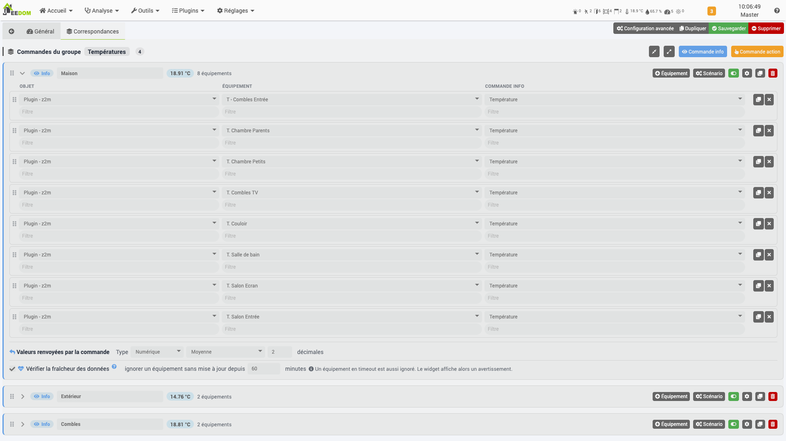

### Comando acción

Para cada equipo: uno o varios comandos acción, ejecutados en orden. El botón **+ Commande** encadena varias acciones sobre un mismo equipo (p. ej. `On`, luego `Brillo` a 254, luego `Color`).

El campo **Valor** se adapta al tipo de comando: número (con el rango permitido como indicación, p. ej. `153 a 500`, y la entrada limitada a ese rango), color, lista o mensaje. Para un comando sin valor (p. ej. `On`), no se muestra ningún campo.

La **pausa entre dos acciones** (de 0 a 30 segundos) espacia cada acción: útil para las bombillas que ignoran un color enviado justo después de encenderse.

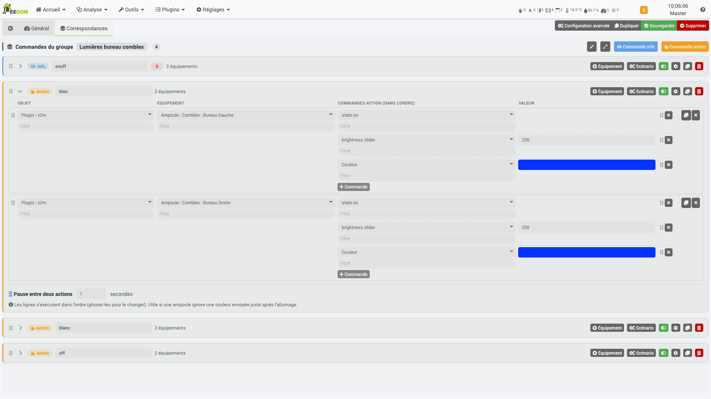

### Añadir escenarios

El botón **Escenario** del encabezado de un comando añade una línea escenario. Elija el **grupo de escenarios** (opcional, filtra la lista) y luego el **escenario**.

- **En un comando info**, la línea se refiere al estado del escenario: **está activo** / **está inactivo** (escenario activado o desactivado en Jeedom), **está en curso** / **está detenido** (escenario ejecutándose o no). Cuenta como una línea de la regla, o vale `1` / `0` en un cálculo numérico. Las líneas escenario se agrupan en un **bloque separado**, debajo de los equipos, con sus propias columnas (*Grupo de escenarios*, *Escenario*, *Estado esperado*). Jeedom no indica los cambios de estado de un escenario: estas líneas se recalculan cada minuto (o inmediatamente con el comando *Refrescar*).
- **En un comando acción**, la línea **lanza**, **detiene**, **activa** o **desactiva** el escenario. Se ejecuta en su lugar en la lista, junto con los equipos (p. ej. encender las luces y luego iniciar el escenario «Ambiente noche»): arrástrela para cambiar el orden. Las columnas pasan a ser *Objeto / Grupo* y *Equipo / Escenario*.
- El botón <i class="fas fa-clone"></i> clona una línea escenario: mismo grupo y misma acción / estado, escenario por elegir.

Ejemplo, un grupo **Alarma**:

- comando info `etat` (tipo *Otro*, valores `on` / `off`): una línea escenario *0 - Alarme - Activation* **está activo**; vale `on` mientras el escenario esté activado;
- comando acción `activation`: una línea escenario *0 - Alarme - Activation* **Lanzar**, y luego una línea equipo (*Google Home Parle*) que anuncia «Alarme activée»; escenarios y equipos se encadenan en el orden de la lista.

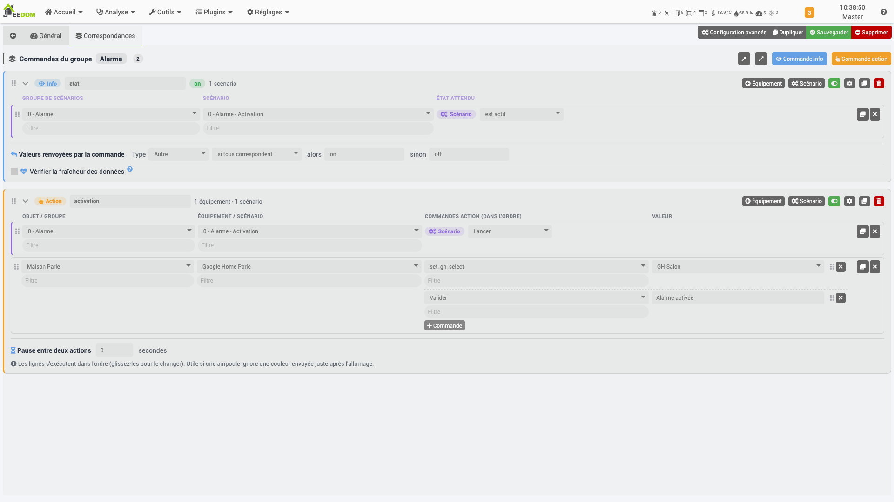

Los escenarios iniciados, detenidos, activados o desactivados por un comando acción aparecen en la pestaña *General*, bloque **Escenarios vinculados** > *Controlados por este grupo*, con el comando y la acción:

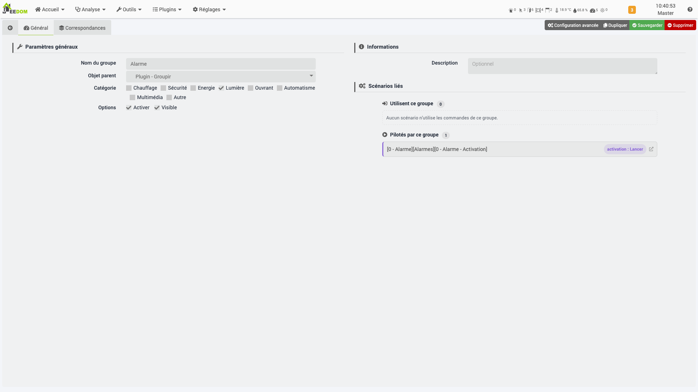

### Organizar los comandos

- <i class="fas fa-grip-vertical"></i> **Arrastrar y soltar**: reordena los comandos (y por tanto los botones del widget), las líneas y las acciones de un equipo.
- <i class="fas fa-chevron-right"></i> **Plegar / desplegar**: los comandos aparecen plegados al abrir el grupo; los botones de arriba a la derecha los pliegan o despliegan todos. Plegado, un comando info muestra su **valor actual** en su encabezado (verde o rojo según la regla, azul para un cálculo numérico, con <i class="fas fa-exclamation-triangle"></i> si se ignoran equipos), actualizado en directo, así como el número de equipos y escenarios. El **nombre del grupo** se recuerda junto a «Comandos del grupo».
- <i class="fas fa-clone"></i> **Clonar una línea**: añade una línea con el mismo objeto y las mismas acciones; al elegir el equipo, se seleccionan sus comandos con el mismo nombre y los mismos valores. Una línea escenario también se puede clonar: mismo grupo y misma acción / estado, escenario por elegir.
- <i class="fas fa-clone"></i> **Clonar un comando**: duplica el comando completo, con el nombre «… (copie)».
- <i class="fas fa-cog"></i> **Configuración**: abre la configuración Jeedom del comando (historial, tipo genérico, alertas), una vez guardado el grupo.

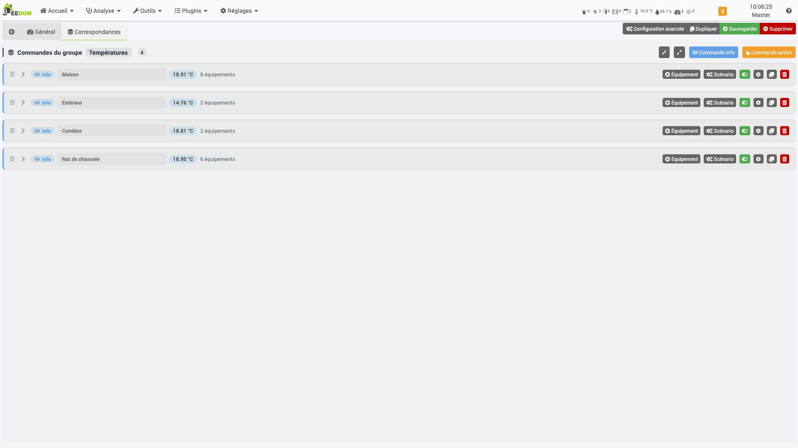

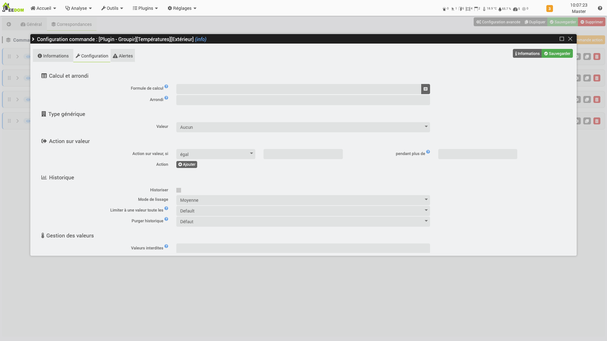

Una línea cuyo equipo, comando o escenario se ha eliminado se muestra **en rojo**. No se puede guardar mientras haya una línea incompleta; un mensaje indica el comando y la línea que hay que corregir.

Comandos de un grupo
===

| Comando | Tipo | Función |
|---|---|---|
| *uno por comando info* | info | Valor «alors» o «sinon» según la regla, o resultado del cálculo (Numérico: media, más alto...) |
| *uno por comando acción* | action | Ejecuta las líneas del comando, en orden |
| Refrescar | action | Recalcula todos los comandos info del grupo |

Ejemplo en un escenario: disparador *[Salón][Luces del salón][on] igual a 1*, acción *[Salón][Luces del salón][Encender]*.

Widget
===

Cada grupo tiene su propio widget:

- una línea por comando info, con un punto verde o rojo según la regla (azul para un cálculo numérico), el número de equipos conformes (p. ej. `2/2`) o de valores, y el valor del comando con su unidad (p. ej. `18.9 °C`); el icono <i class="fas fa-exclamation-triangle"></i> señala equipos ignorados por falta de actualización reciente (pase el ratón por encima para ver la lista);
- el **color actual** de cada luz del grupo (leído en la info de estado de su comando de color, o en una info de tipo genérico *Color de luz*);
- un botón por comando acción;
- el icono <i class="fas fa-sync-alt"></i> recalcula el estado del grupo.

El widget se actualiza en directo. Un comando oculto (icono <i class="fas fa-cog"></i> > *Mostrar*) no aparece en él.
