Description
===

Groupir permet de **grouper des équipements** (et des scénarios). Chaque groupe, par exemple « Lumières salon », est un équipement Jeedom qui expose ses propres commandes :

- des **commandes info**, qui donnent l'état du groupe (ex. `on` vaut `1` si toutes les lumières sont allumées, ou la température moyenne des pièces) ;
- des **commandes action**, qui pilotent tous les équipements d'un coup (ex. `Allumer` allume les lumières, règle leur luminosité et leur couleur).

Ces commandes s'utilisent comme n'importe quelle commande Jeedom : scénarios, widgets, historique, alertes...

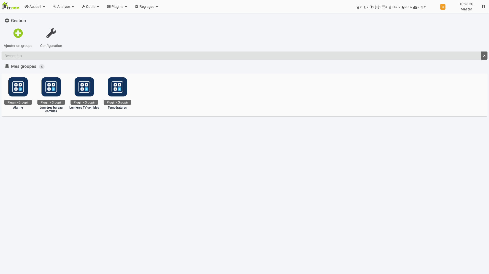

Configuration du plugin
===

Après l'installation depuis le Market, activez le plugin. **Aucune configuration globale n'est nécessaire** : chaque groupe se configure depuis son équipement, dans l'onglet *Correspondances*.

La fonctionnalité **cron** est active : chaque minute, le plugin recalcule les groupes dont une commande info dépend de l'état d'un scénario ou vérifie la fraîcheur des données. Le niveau de log *Debug* détaille chaque recalcul et chaque action exécutée, ce qui aide au diagnostic.

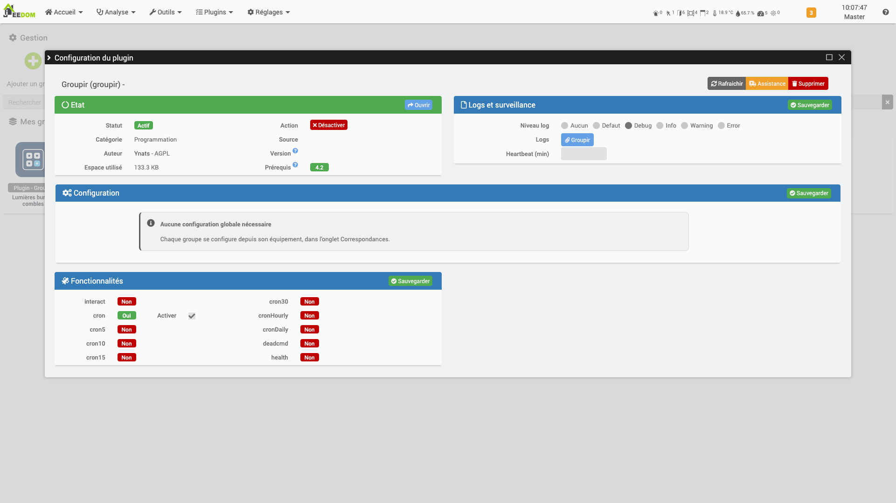

L'interface est disponible en français, anglais, allemand, espagnol et italien.

Créer un groupe
===

Cliquez sur **Ajouter un groupe**, donnez-lui un nom, puis configurez les deux onglets.

Onglet « Général »
---

Nom, objet parent, catégorie, options *Activer* / *Visible* et description, comme pour tout équipement.

Le bloc **Scénarios liés** liste :

- les scénarios qui **utilisent ce groupe** (une de ses commandes en déclencheur, condition ou action) ;
- les scénarios **pilotés par ce groupe** (lancés, arrêtés, activés ou désactivés par une de ses commandes action).

Un clic ouvre le scénario.

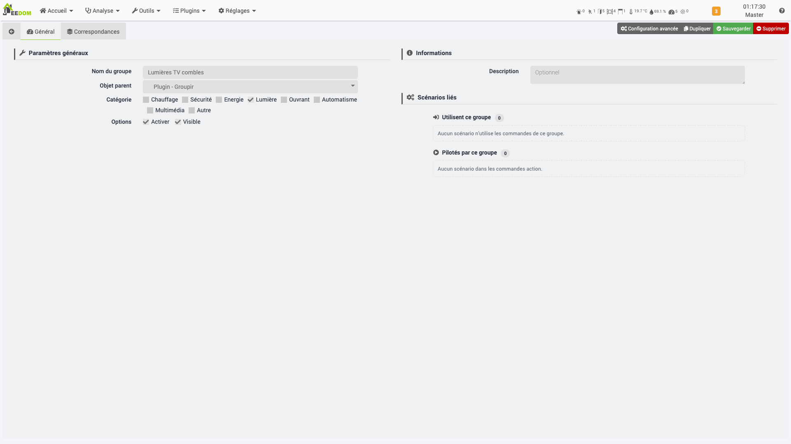

Onglet « Correspondances »
---

Le groupe contient des **commandes**, chacune étant un sous-groupe d'équipements :

- **Commande info** (pastille bleue) : calcule un état à partir des équipements ;
- **Commande action** (pastille orange) : exécute des actions sur les équipements.

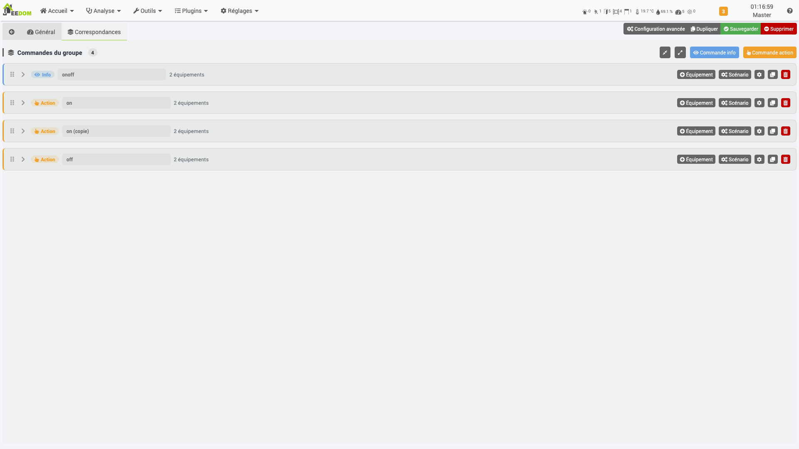

Donnez un **nom** à la commande : ce sera le nom de la commande du groupe. Ajoutez ensuite une ligne par équipement avec le bouton **Équipement** (ou par scénario avec le bouton **Scénario**). Chaque ligne se remplit de gauche à droite : **Objet**, **Équipement**, **Commande**. Chaque liste a un champ *Filtre* ; un filtre qui ne laisse qu'un résultat le sélectionne automatiquement, et dans une commande action, un équipement déjà présent n'est plus proposé. Dans une commande info, un même équipement peut revenir sur plusieurs lignes (ex. température et humidité d'une même sonde), mais une commande info déjà choisie n'est plus proposée.

Le bouton **interrupteur** de l'en-tête active ou désactive une commande sans la supprimer. Une commande désactivée n'est plus calculée ni affichée dans le widget, et une commande action désactivée n'exécute plus rien. Sa commande Jeedom est conservée (historique, scénarios qui l'utilisent) et une commande info garde sa dernière valeur.

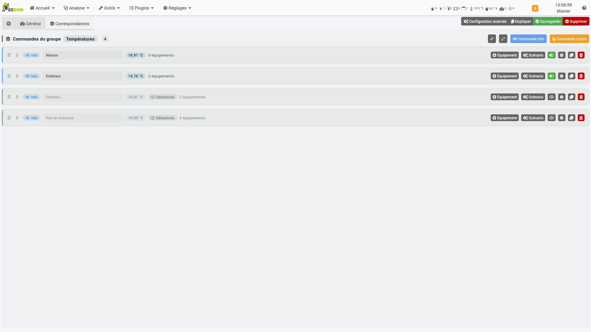

### Commande info

Pour chaque équipement : la commande info, une condition (*égal à*, *différent de*, *supérieur à*, *contient*...) et la **valeur attendue** (la valeur actuelle est affichée en indication).

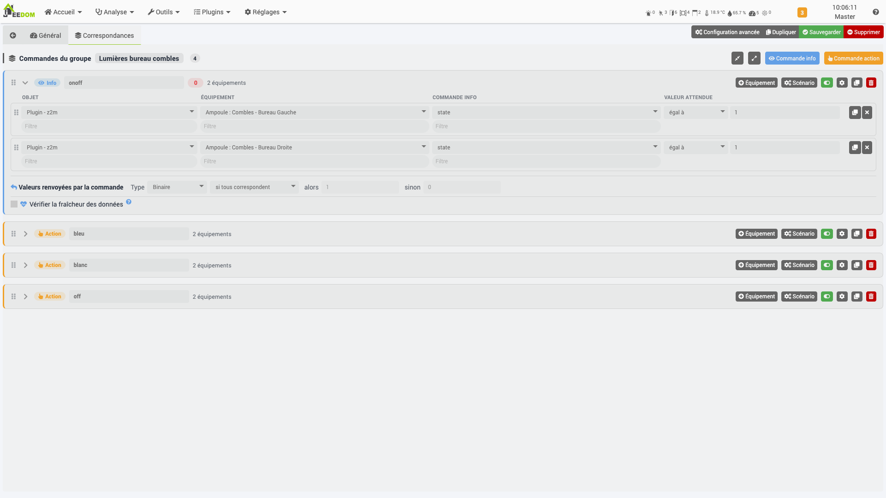

Le **type** de la commande se choisit comme dans Jeedom, et les options proposées en dépendent :

- **Binaire** : la commande vaut `1` si la règle est respectée, sinon `0` (compatible avec les widgets et types génériques binaires) ;
- **Numérique** : la commande calcule une valeur à partir des lignes :
  - **Moyenne**, **Plus haut**, **Plus bas**, **Somme** ou **Médiane** des valeurs des commandes info (ex. température moyenne des pièces), avec le nombre de **décimales** choisi. La condition et la valeur attendue des lignes ne servent pas ; un scénario compte pour `1` s'il est dans l'état choisi, `0` sinon. L'unité de la première info (ex. `°C`) est reprise automatiquement et suit les infos choisies (ex. `%` si vous passez à l'humidité) ; une unité saisie à la main dans la configuration de la commande est conservée ;
  - **Nombre de correspondances** : nombre de lignes qui respectent leur condition (ex. nombre de fenêtres ouvertes) ;
  - **Selon la règle (alors / sinon)** : comme Autre, avec des valeurs numériques (par défaut `1` / `0`) ;
- **Autre** : texte libre, la commande prend la valeur **alors** (par défaut `on`) si la règle est respectée, sinon la valeur **sinon** (par défaut `off`).

La règle (Binaire, Autre, et Numérique « selon la règle ») :

- **si tous correspondent** (par défaut) : toutes les lignes doivent correspondre ;
- **si au moins un correspond** : ex. « au moins une lumière allumée » ;
- **si au moins N correspondent** : ex. au moins 2 fenêtres ouvertes sur 4.

**Détection du type** : d'après les commandes info choisies (binaires ou valeurs `0` / `1` : Binaire ; numériques : Numérique ; sinon Autre), le plugin **propose** de changer le type. Rien n'est modifié sans votre accord : cliquez sur *Passer en...* pour accepter ou sur *Garder...* pour ignorer la proposition.

**Vérifier la fraîcheur des données** (option de chaque commande info, désactivée par défaut) : une ligne dont l'équipement n'a pas été mis à jour depuis le délai choisi (60 minutes par défaut), ou que Jeedom signale en timeout, est **ignorée** : elle ne compte ni dans la règle ni dans le calcul. Exemple : une sonde de température sans pile ne fausse plus la moyenne. La dernière mise à jour retenue est la plus récente entre la dernière communication de l'équipement et la date de la valeur. Le widget affiche alors un **avertissement** (survolez-le pour la liste des équipements en défaut), et la défaillance puis le retour à la normale sont notés dans le log du plugin. Cette vérification est refaite chaque minute.

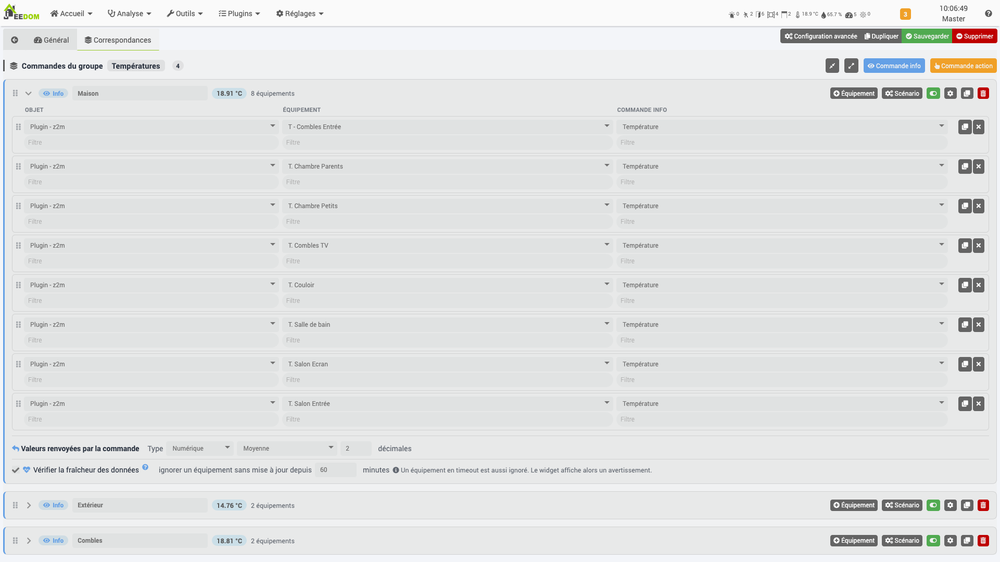

### Commande action

Pour chaque équipement : une ou plusieurs commandes action, exécutées dans l'ordre. Le bouton **+ Commande** enchaîne plusieurs actions sur un même équipement (ex. `On`, puis `Luminosité` à 254, puis `Couleur`).

Le champ **Valeur** s'adapte au type de la commande : nombre (avec la plage autorisée en indication, ex. `153 à 500`, et la saisie limitée à cette plage), couleur, liste ou message. Pour une commande sans valeur (ex. `On`), aucun champ n'est affiché.

La **pause entre deux actions** (0 à 30 secondes) espace chaque action : utile pour les ampoules qui ignorent une couleur envoyée juste après l'allumage.

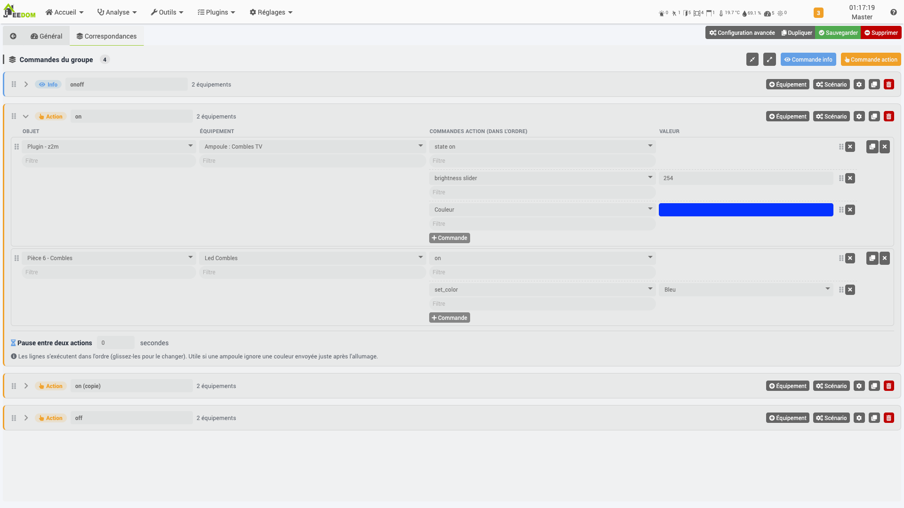

### Ajouter des scénarios

Le bouton **Scénario** de l'en-tête d'une commande ajoute une ligne scénario. Choisissez le **groupe de scénarios** (facultatif, il filtre la liste), puis le **scénario**.

- **Dans une commande info**, la ligne porte sur l'état du scénario : **est actif** / **est inactif** (scénario activé ou désactivé dans Jeedom), **est en cours** / **est arrêté** (scénario en train de s'exécuter ou non). Elle compte comme une ligne de la règle, ou vaut `1` / `0` dans un calcul numérique. Les lignes scénario sont regroupées dans un **bloc séparé**, sous les équipements, avec leurs propres colonnes (*Groupe de scénarios*, *Scénario*, *État attendu*). Jeedom ne signale pas les changements d'état d'un scénario : ces lignes sont recalculées chaque minute (ou immédiatement avec la commande *Rafraîchir*).
- **Dans une commande action**, la ligne **lance**, **arrête**, **active** ou **désactive** le scénario. Elle s'exécute à sa place dans la liste, avec les équipements (ex. allumer les lumières, puis lancer le scénario « Ambiance soirée ») : glissez-la pour changer l'ordre. Les colonnes deviennent alors *Objet / Groupe* et *Équipement / Scénario*.
- Le bouton <i class="fas fa-clone"></i> clone une ligne scénario : même groupe et même action / état, scénario à choisir.

Exemple, un groupe **Alarme** :

- commande info `etat` (type *Autre*, valeurs `on` / `off`) : une ligne scénario *0 - Alarme - Activation* **est actif** ; elle vaut `on` tant que le scénario est activé ;
- commande action `activation` : une ligne scénario *0 - Alarme - Activation* **Lancer**, puis une ligne équipement (*Google Home Parle*) qui annonce « Alarme activée » ; scénarios et équipements s'enchaînent dans l'ordre de la liste.

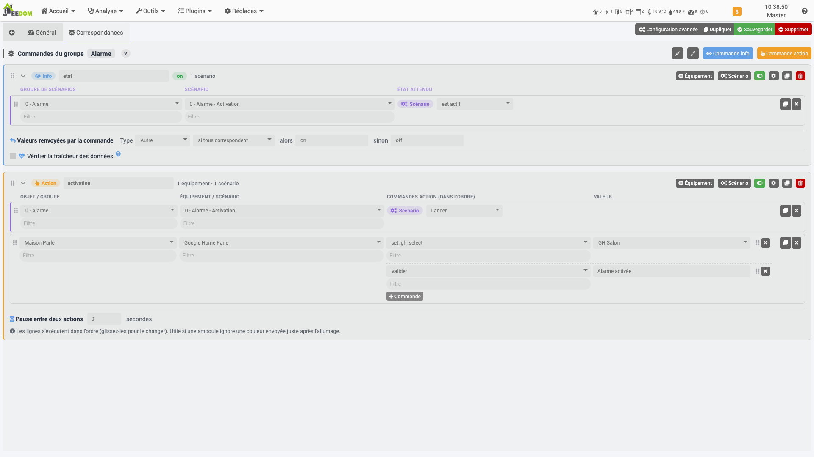

Les scénarios lancés, arrêtés, activés ou désactivés par une commande action apparaissent dans l'onglet *Général*, bloc **Scénarios liés** > *Pilotés par ce groupe*, avec la commande et l'action :

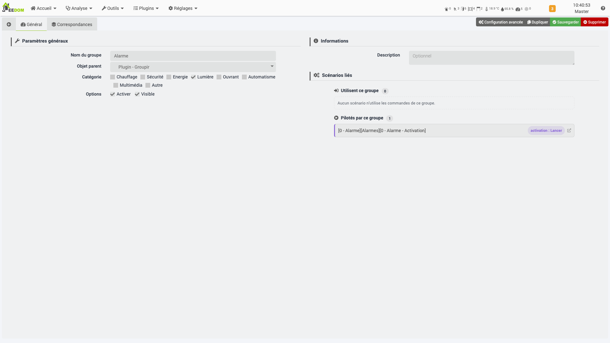

### Organiser les commandes

- <i class="fas fa-grip-vertical"></i> **Glisser-déposer** : réordonne les commandes (et donc les boutons du widget), les lignes et les actions d'un équipement.
- <i class="fas fa-chevron-right"></i> **Plier / déplier** : les commandes sont pliées à l'ouverture ; les boutons en haut à droite plient ou déplient tout. Pliée, une commande info affiche sa **valeur actuelle** dans son en-tête (verte ou rouge selon la règle, bleue pour un calcul numérique, avec <i class="fas fa-exclamation-triangle"></i> si des équipements sont ignorés), mise à jour en direct, ainsi que le nombre d'équipements et de scénarios. Le **nom du groupe** est rappelé à côté de « Commandes du groupe ».
- <i class="fas fa-clone"></i> **Cloner une ligne** : ajoute une ligne avec le même objet et les mêmes actions ; une fois l'équipement choisi, ses commandes portant les mêmes noms sont sélectionnées avec les mêmes valeurs. Une ligne scénario se clone aussi : même groupe et même action / état, scénario à choisir.
- <i class="fas fa-clone"></i> **Cloner une commande** : duplique la commande entière, nommée « … (copie) ».
- <i class="fas fa-cog"></i> **Configuration** : ouvre la configuration Jeedom de la commande (historique, type générique, alertes), une fois le groupe enregistré.

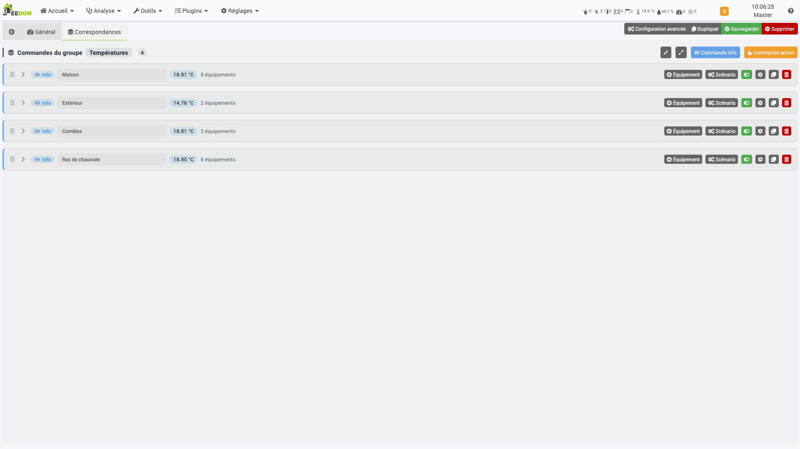

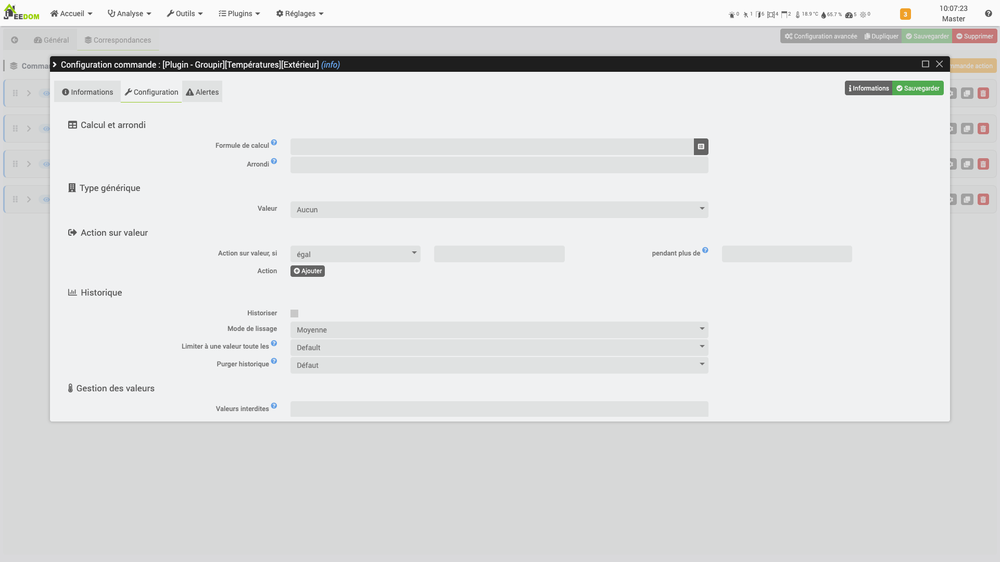

Une ligne dont l'équipement, la commande ou le scénario a été supprimé est signalée **en rouge**. L'enregistrement est refusé tant qu'une ligne est incomplète, avec un message qui indique la commande et la ligne à corriger.

Commandes d'un groupe
===

| Commande | Type | Rôle |
|---|---|---|
| *une par commande info* | info | Valeur « alors » ou « sinon » selon la règle, ou résultat du calcul (Numérique : moyenne, plus haut...) |
| *une par commande action* | action | Exécute les lignes de la commande, dans l'ordre |
| Rafraîchir | action | Recalcule toutes les commandes info du groupe |

Exemple dans un scénario : déclencheur *[Salon][Lumières salon][on] égal à 1*, action *[Salon][Lumières salon][Allumer]*.

Widget
===

Chaque groupe a son propre widget :

- une ligne par commande info, avec une pastille verte ou rouge selon la règle (bleue pour un calcul numérique), le nombre d'équipements conformes (ex. `2/2`) ou de valeurs, et la valeur de la commande avec son unité (ex. `18.9 °C`) ; l'icône <i class="fas fa-exclamation-triangle"></i> signale des équipements ignorés faute de mise à jour récente (survolez-la pour la liste) ;
- la **couleur actuelle** de chaque lumière du groupe (lue sur l'info d'état de sa commande couleur, ou sur une info de type générique *Couleur lumière*) ;
- un bouton par commande action ;
- l'icône <i class="fas fa-sync-alt"></i> recalcule l'état du groupe.

Le widget se met à jour en direct. Une commande masquée (icône <i class="fas fa-cog"></i> > *Afficher*) n'y apparaît pas.
