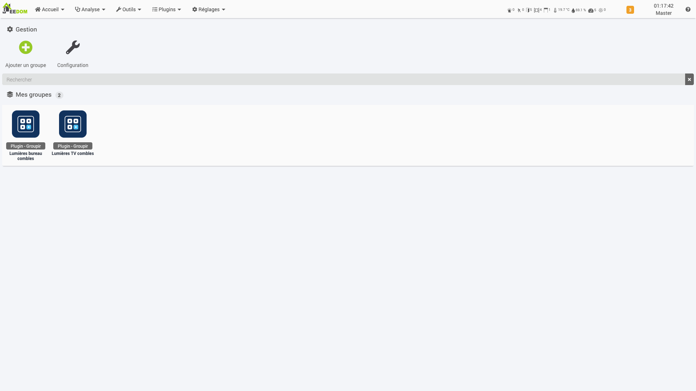
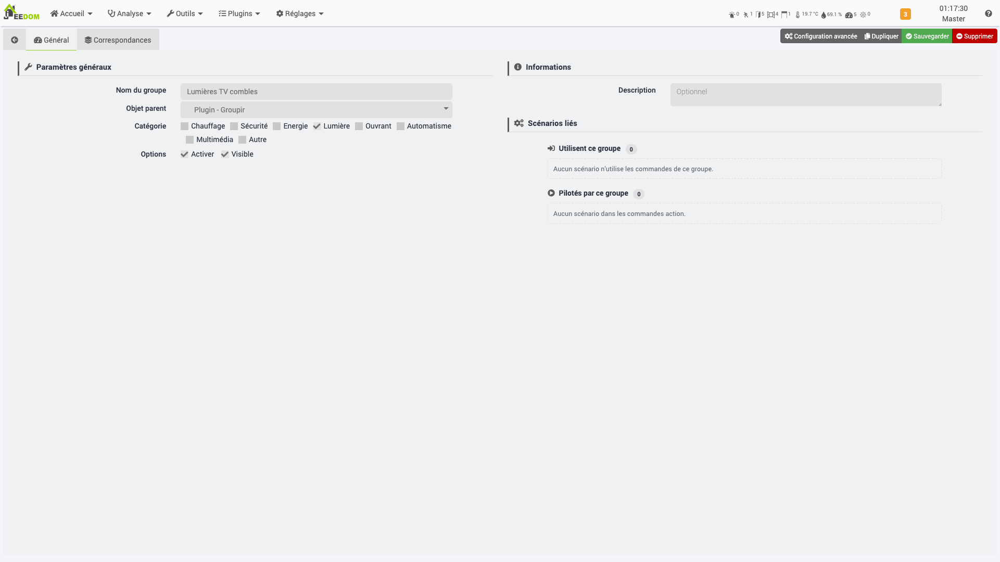
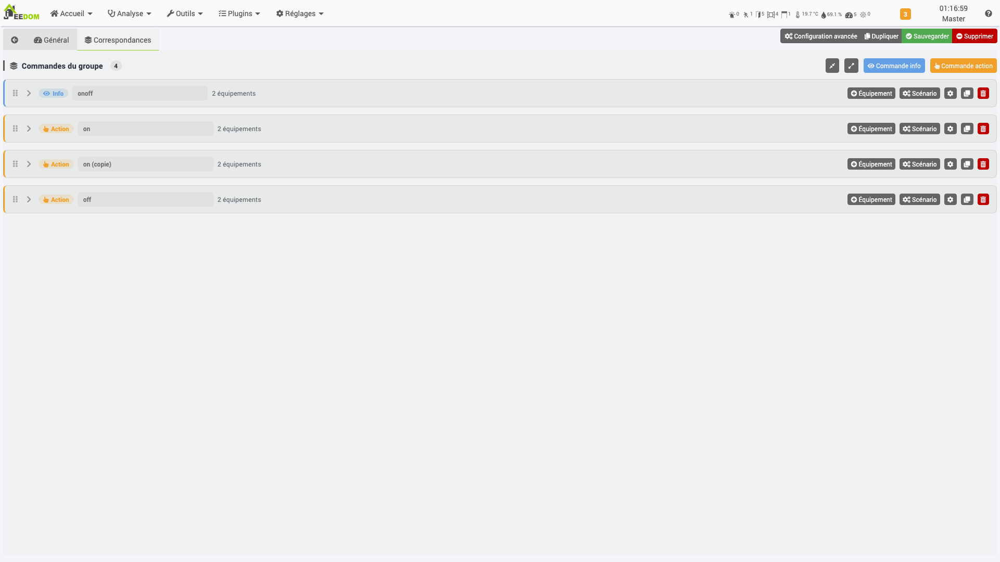
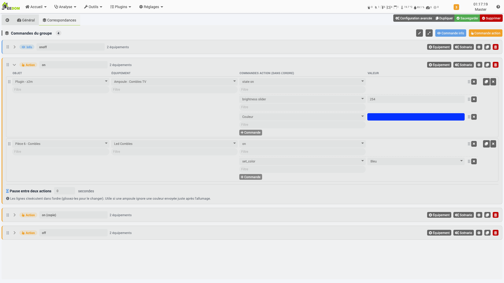

Descrizione
===

Groupir permette di **raggruppare dispositivi** (e scenari). Ogni gruppo, ad esempio «Luci soggiorno», è un dispositivo Jeedom con i propri comandi:

- **comandi info**, che indicano se i dispositivi del gruppo sono nello stato atteso (es. `on` vale `ok` se tutte le luci sono accese);
- **comandi azione**, che controllano tutti i dispositivi in una volta (es. `Accendi` accende le luci e ne regola luminosità e colore).

Questi comandi si usano come qualsiasi comando Jeedom: scenari, widget, cronologia, avvisi...

Configurazione del plugin
===

Dopo l'installazione dal Market, attiva il plugin. **Non è necessaria alcuna configurazione globale**: ogni gruppo si configura dal suo dispositivo, nella scheda *Corrispondenze*.

La funzione **cron** è attiva: ogni minuto, il plugin ricalcola i gruppi i cui comandi info dipendono dallo stato di uno scenario. Il livello di log *Debug* dettaglia ogni ricalcolo e ogni azione eseguita, utile per la diagnosi.

L'interfaccia è disponibile in francese, inglese, tedesco, spagnolo e italiano.

Creare un gruppo
===

Fate clic su **Aggiungi un gruppo**, assegnate un nome, poi configurate le due schede.

Scheda «Generale»
---

Nome, oggetto padre, categoria, opzioni *Attiva* / *Visibile* e descrizione, come per qualsiasi dispositivo.

Il blocco **Scenari collegati** elenca:

- gli scenari che **usano questo gruppo** (uno dei suoi comandi come trigger, condizione o azione);
- gli scenari **controllati da questo gruppo** (avviati, fermati, attivati o disattivati da uno dei suoi comandi azione).

Un clic apre lo scenario.

Scheda «Corrispondenze»
---

Il gruppo contiene dei **comandi**, ognuno dei quali è un sottogruppo di dispositivi:

- **Comando info** (etichetta blu): calcola uno stato a partire dai dispositivi;
- **Comando azione** (etichetta arancione): esegue azioni sui dispositivi.

Assegnate un **nome** al comando: sarà il nome del comando del gruppo. Aggiungete poi una riga per dispositivo con il pulsante **Dispositivo** (o per scenario con il pulsante **Scenario**). Ogni riga si compila da sinistra a destra: **Oggetto**, **Dispositivo**, **Comando**. Ogni elenco ha un campo *Filtro*; un filtro che lascia un solo risultato lo seleziona automaticamente, e un dispositivo già presente nel comando non viene più proposto.

### Comando info

Per ogni dispositivo: il comando info, una condizione (*uguale a*, *diverso da*, *maggiore di*, *contiene*...) e il **valore atteso** (il valore attuale è mostrato come suggerimento).

I **valori restituiti dal comando** dipendono da una regola:

- **se tutti corrispondono** (predefinito): tutte le righe devono corrispondere;
- **se almeno uno corrisponde**: es. «almeno una luce accesa»;
- **se almeno N corrispondono**: es. almeno 2 finestre aperte su 4.

Il comando assume allora il valore **alors** (allora, predefinito `ok`), altrimenti il valore **sinon** (altrimenti, predefinito `ko`). Se entrambi i valori sono numerici (es. `1` / `0`), il comando è numerico e può essere storicizzato in un grafico.

Una riga **Scenario** riguarda lo stato di uno scenario: **è attivo**, **è inattivo**, **è in corso** o **è fermo**. Jeedom non segnala i cambi di stato di uno scenario: queste righe vengono ricalcolate ogni minuto (o subito con il comando *Aggiorna*).

### Comando azione

Per ogni dispositivo: uno o più comandi azione, eseguiti in ordine. Il pulsante **+ Commande** concatena più azioni sullo stesso dispositivo (es. `On`, poi `Luminosità` a 254, poi `Colore`).

Il campo **Valore** si adatta al tipo di comando: numero (con l'intervallo consentito come suggerimento, es. `153 a 500`, e l'inserimento limitato a tale intervallo), colore, elenco o messaggio. Per un comando senza valore (es. `On`) non viene mostrato alcun campo.

Una riga **Scenario** avvia, ferma, attiva o disattiva uno scenario, in ordine con i dispositivi (es. accendere le luci, poi avviare lo scenario «Atmosfera serale»).

La **pausa tra due azioni** (da 0 a 30 secondi) distanzia ogni azione: utile per le lampadine che ignorano un colore inviato subito dopo l'accensione.

### Organizzare i comandi

- <i class="fas fa-grip-vertical"></i> **Trascina e rilascia**: riordina i comandi (e quindi i pulsanti del widget), le righe e le azioni di un dispositivo.
- <i class="fas fa-chevron-right"></i> **Comprimi / espandi**: i comandi sono compressi all'apertura del gruppo; i pulsanti in alto a destra li comprimono o li espandono tutti.
- <i class="fas fa-clone"></i> **Clona una riga**: aggiunge una riga con lo stesso oggetto e le stesse azioni; scelto il dispositivo, vengono selezionati i suoi comandi con lo stesso nome e gli stessi valori.
- <i class="fas fa-clone"></i> **Clona un comando**: duplica l'intero comando, con il nome «… (copie)».
- <i class="fas fa-cog"></i> **Configurazione**: apre la configurazione Jeedom del comando (cronologia, tipo generico, avvisi, visualizzazione), dopo aver salvato il gruppo.

Una riga il cui dispositivo, comando o scenario è stato eliminato è mostrata **in rosso**. Il salvataggio è rifiutato finché una riga è incompleta, con un messaggio che indica il comando e la riga da correggere.

Comandi di un gruppo
===

| Comando | Tipo | Ruolo |
|---|---|---|
| *uno per comando info* | info | Valore «alors» o «sinon» secondo la regola |
| *uno per comando azione* | action | Esegue le righe del comando, in ordine |
| Aggiorna | action | Ricalcola tutti i comandi info del gruppo |

Esempio in uno scenario: trigger *[Soggiorno][Luci soggiorno][on] uguale a ok*, azione *[Soggiorno][Luci soggiorno][Accendi]*.

Widget
===

Ogni gruppo ha il proprio widget:

- una riga per comando info, con un pallino verde o rosso, il numero di dispositivi conformi (es. `2/2`) e il valore del comando;
- il **colore attuale** di ogni luce del gruppo (letto dall'info di stato del suo comando colore, o da un'info di tipo generico *Colore luce*);
- un pulsante per comando azione;
- l'icona <i class="fas fa-sync-alt"></i> ricalcola lo stato del gruppo.

Il widget si aggiorna in tempo reale. Un comando nascosto (icona <i class="fas fa-cog"></i> > *Visualizza*) non vi compare.
