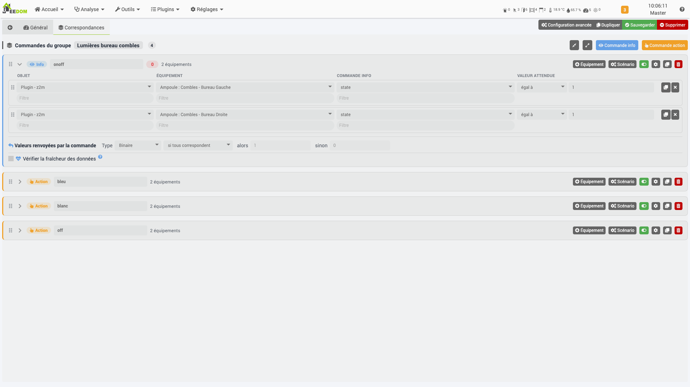
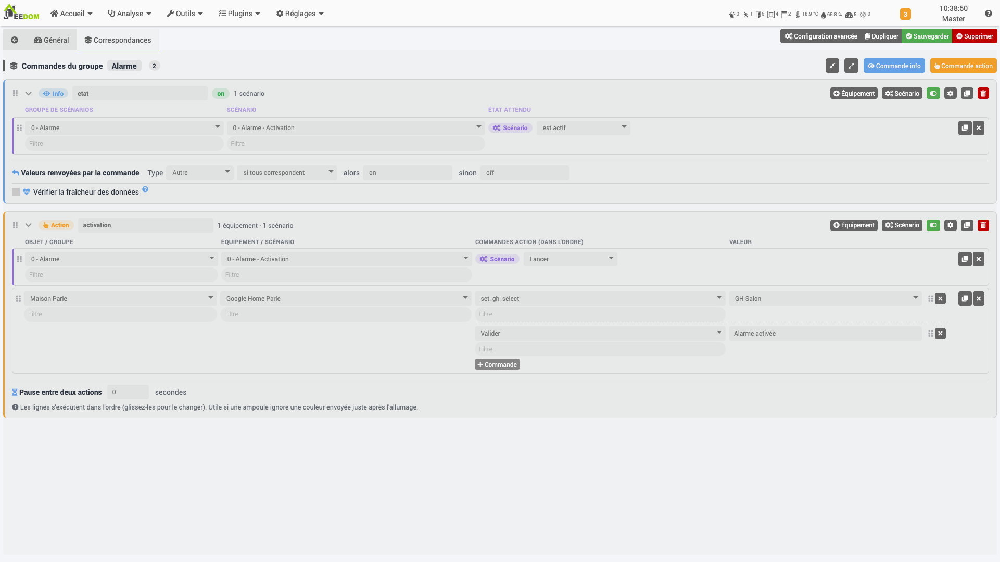

Descrizione
===

Groupir permette di **raggruppare dispositivi** (e scenari). Ogni gruppo, ad esempio «Luci soggiorno», è un dispositivo Jeedom con i propri comandi:

- **comandi info**, che danno lo stato del gruppo (es. `on` vale `1` se tutte le luci sono accese, o la temperatura media delle stanze);
- **comandi azione**, che controllano tutti i dispositivi in una volta (es. `Accendi` accende le luci e ne regola luminosità e colore).

Questi comandi si usano come qualsiasi comando Jeedom: scenari, widget, cronologia, avvisi...

Configurazione del plugin
===

Dopo l'installazione dal Market, attiva il plugin. **Non è necessaria alcuna configurazione globale**: ogni gruppo si configura dal suo dispositivo, nella scheda *Corrispondenze*.

La funzione **cron** è attiva: ogni minuto, il plugin ricalcola i gruppi i cui comandi info dipendono dallo stato di uno scenario o verificano l'aggiornamento dei dati. Il livello di log *Debug* descrive ogni ricalcolo e ogni azione eseguita, il che aiuta nella diagnosi.

L'interfaccia è disponibile in francese, inglese, tedesco, spagnolo e italiano.

Creare un gruppo
===

Fate clic su **Aggiungi un gruppo**, assegnate un nome, poi configurate le due schede.

Scheda «Generale»
---

Nome, oggetto padre, categoria, opzioni *Attiva* / *Visibile* e descrizione, come per qualsiasi dispositivo.

Il blocco **Scenari collegati** elenca:

- gli scenari che **usano questo gruppo** (uno dei suoi comandi come trigger, condizione o azione);
- gli scenari **controllati da questo gruppo** (avviati, fermati, attivati o disattivati da uno dei suoi comandi azione).

Un clic apre lo scenario.

Scheda «Corrispondenze»
---

Il gruppo contiene dei **comandi**, ognuno dei quali è un sottogruppo di dispositivi:

- **Comando info** (etichetta blu): calcola uno stato a partire dai dispositivi;
- **Comando azione** (etichetta arancione): esegue azioni sui dispositivi.

Assegnate un **nome** al comando: sarà il nome del comando del gruppo. Aggiungete poi una riga per dispositivo con il pulsante **Dispositivo** (o per scenario con il pulsante **Scenario**). Ogni riga si compila da sinistra a destra: **Oggetto**, **Dispositivo**, **Comando**. Ogni elenco ha un campo *Filtro*; un filtro che lascia un solo risultato lo seleziona automaticamente, e in un comando azione, un dispositivo già presente non viene più proposto. In un comando info, lo stesso dispositivo può comparire su più righe (es. temperatura e umidità della stessa sonda), ma un comando info già scelto non viene più proposto.

Il pulsante **interruttore** nell'intestazione attiva o disattiva un comando senza eliminarlo. Un comando disattivato non viene più calcolato né mostrato nel widget, e un comando azione disattivato non esegue più nulla. Il suo comando Jeedom viene conservato (cronologia, scenari che lo usano) e un comando info mantiene il suo ultimo valore.

### Comando info

Per ogni dispositivo: il comando info, una condizione (*uguale a*, *diverso da*, *maggiore di*, *contiene*...) e il **valore atteso** (il valore attuale è mostrato come suggerimento).

Il **tipo** del comando si sceglie come in Jeedom, e le opzioni proposte dipendono da esso:

- **Binario**: il comando vale `1` se la regola è rispettata, altrimenti `0` (compatibile con i widget e i tipi generici binari);
- **Numerico**: il comando calcola un valore a partire dalle righe:
  - **Media**, **Più alto**, **Più basso**, **Somma** o **Mediana** dei valori dei comandi info (es. temperatura media delle stanze), con il numero di **decimali** scelto. La condizione e il valore atteso delle righe non sono usati; uno scenario conta `1` se è nello stato scelto, `0` altrimenti. L'unità della prima info (es. `°C`) viene ripresa automaticamente e segue le info scelte (es. `%` se passate all'umidità); un'unità inserita a mano nella configurazione del comando viene mantenuta;
  - **Numero di corrispondenze**: numero di righe che rispettano la loro condizione (es. numero di finestre aperte);
  - **Secondo la regola (allora / altrimenti)**: come Altro, con valori numerici (predefinito `1` / `0`);
- **Altro**: testo libero, il comando assume il valore **alors** (predefinito `on`) se la regola è rispettata, altrimenti il valore **sinon** (predefinito `off`).

La regola (Binario, Altro e Numerico «secondo la regola»):

- **se tutti corrispondono** (predefinito): tutte le righe devono corrispondere;
- **se almeno uno corrisponde**: es. «almeno una luce accesa»;
- **se almeno N corrispondono**: es. almeno 2 finestre aperte su 4.

**Rilevamento del tipo**: in base ai comandi info scelti (binari o valori `0` / `1`: Binario; numerici: Numerico; altrimenti Altro), il plugin **propone** di cambiare il tipo. Nulla cambia senza il vostro consenso: cliccate su *Passa a...* per accettare o su *Mantieni...* per ignorare la proposta.

**Verifica l'aggiornamento dei dati** (opzione di ogni comando info, disattivata per impostazione predefinita): una riga il cui dispositivo non è stato aggiornato entro il ritardo scelto (60 minuti per impostazione predefinita), o che Jeedom segnala in timeout, viene **ignorata**: non conta né nella regola né nel calcolo. Esempio: una sonda di temperatura senza batteria non falsa più la media. L'ultimo aggiornamento considerato è il più recente tra l'ultima comunicazione del dispositivo e la data del valore. Il widget mostra allora un **avviso** (passate il mouse sopra per l'elenco dei dispositivi in guasto), e il guasto e il ritorno alla normalità sono annotati nel log del plugin. Questa verifica viene ripetuta ogni minuto.

### Comando azione

Per ogni dispositivo: uno o più comandi azione, eseguiti in ordine. Il pulsante **+ Commande** concatena più azioni sullo stesso dispositivo (es. `On`, poi `Luminosità` a 254, poi `Colore`).

Il campo **Valore** si adatta al tipo di comando: numero (con l'intervallo consentito come suggerimento, es. `153 a 500`, e l'inserimento limitato a tale intervallo), colore, elenco o messaggio. Per un comando senza valore (es. `On`) non viene mostrato alcun campo.

La **pausa tra due azioni** (da 0 a 30 secondi) distanzia ogni azione: utile per le lampadine che ignorano un colore inviato subito dopo l'accensione.

### Aggiungere scenari

Il pulsante **Scenario** nell'intestazione di un comando aggiunge una riga scenario. Scegliete il **gruppo di scenari** (facoltativo, filtra l'elenco), poi lo **scenario**.

- **In un comando info**, la riga riguarda lo stato dello scenario: **è attivo** / **è inattivo** (scenario attivato o disattivato in Jeedom), **è in corso** / **è fermo** (scenario in esecuzione o no). Conta come una riga della regola, o vale `1` / `0` in un calcolo numerico. Le righe scenario sono raggruppate in un **blocco separato**, sotto i dispositivi, con le proprie colonne (*Gruppo di scenari*, *Scenario*, *Stato atteso*). Jeedom non segnala i cambi di stato di uno scenario: queste righe vengono ricalcolate ogni minuto (o subito con il comando *Aggiorna*).
- **In un comando azione**, la riga **avvia**, **ferma**, **attiva** o **disattiva** lo scenario. Viene eseguita al suo posto nell'elenco, insieme ai dispositivi (es. accendere le luci, poi avviare lo scenario «Atmosfera serale»): trascinatela per cambiare l'ordine. Le colonne diventano allora *Oggetto / Gruppo* e *Dispositivo / Scenario*.
- Il pulsante <i class="fas fa-clone"></i> clona una riga scenario: stesso gruppo e stessa azione / stato, scenario da scegliere.

Esempio, un gruppo **Allarme**:

- comando info `etat` (tipo *Altro*, valori `on` / `off`): una riga scenario *0 - Alarme - Activation* **è attivo**; vale `on` finché lo scenario è attivato;
- comando azione `activation`: una riga scenario *0 - Alarme - Activation* **Avvia**, poi una riga dispositivo (*Google Home Parle*) che annuncia «Alarme activée»; scenari e dispositivi si susseguono nell'ordine dell'elenco.

Gli scenari avviati, fermati, attivati o disattivati da un comando azione compaiono nella scheda *Generale*, blocco **Scenari collegati** > *Controllati da questo gruppo*, con il comando e l'azione:

### Organizzare i comandi

- <i class="fas fa-grip-vertical"></i> **Trascina e rilascia**: riordina i comandi (e quindi i pulsanti del widget), le righe e le azioni di un dispositivo.
- <i class="fas fa-chevron-right"></i> **Comprimi / espandi**: i comandi sono compressi all'apertura del gruppo; i pulsanti in alto a destra li comprimono o li espandono tutti. Compresso, un comando info mostra il suo **valore attuale** nell'intestazione (verde o rosso secondo la regola, blu per un calcolo numerico, con <i class="fas fa-exclamation-triangle"></i> se dei dispositivi sono ignorati), aggiornato in tempo reale, oltre al numero di dispositivi e scenari. Il **nome del gruppo** è ricordato accanto a «Comandi del gruppo».
- <i class="fas fa-clone"></i> **Clona una riga**: aggiunge una riga con lo stesso oggetto e le stesse azioni; scelto il dispositivo, vengono selezionati i suoi comandi con lo stesso nome e gli stessi valori. Anche una riga scenario si può clonare: stesso gruppo e stessa azione / stato, scenario da scegliere.
- <i class="fas fa-clone"></i> **Clona un comando**: duplica l'intero comando, con il nome «… (copie)».
- <i class="fas fa-cog"></i> **Configurazione**: apre la configurazione Jeedom del comando (cronologia, tipo generico, avvisi), dopo aver salvato il gruppo.

Una riga il cui dispositivo, comando o scenario è stato eliminato è mostrata **in rosso**. Il salvataggio è rifiutato finché una riga è incompleta, con un messaggio che indica il comando e la riga da correggere.

Comandi di un gruppo
===

| Comando | Tipo | Ruolo |
|---|---|---|
| *uno per comando info* | info | Valore «alors» o «sinon» secondo la regola, o risultato del calcolo (Numerico: media, più alto...) |
| *uno per comando azione* | action | Esegue le righe del comando, in ordine |
| Aggiorna | action | Ricalcola tutti i comandi info del gruppo |

Esempio in uno scenario: trigger *[Soggiorno][Luci soggiorno][on] uguale a 1*, azione *[Soggiorno][Luci soggiorno][Accendi]*.

Widget
===

Ogni gruppo ha il proprio widget:

- una riga per comando info, con un pallino verde o rosso secondo la regola (blu per un calcolo numerico), il numero di dispositivi conformi (es. `2/2`) o di valori, e il valore del comando con la sua unità (es. `18.9 °C`); l'icona <i class="fas fa-exclamation-triangle"></i> segnala i dispositivi ignorati per mancanza di aggiornamenti recenti (passate il mouse sopra per l'elenco);
- il **colore attuale** di ogni luce del gruppo (letto dall'info di stato del suo comando colore, o da un'info di tipo generico *Colore luce*);
- un pulsante per comando azione;
- l'icona <i class="fas fa-sync-alt"></i> ricalcola lo stato del gruppo.

Il widget si aggiorna in tempo reale. Un comando nascosto (icona <i class="fas fa-cog"></i> > *Visualizza*) non vi compare.
